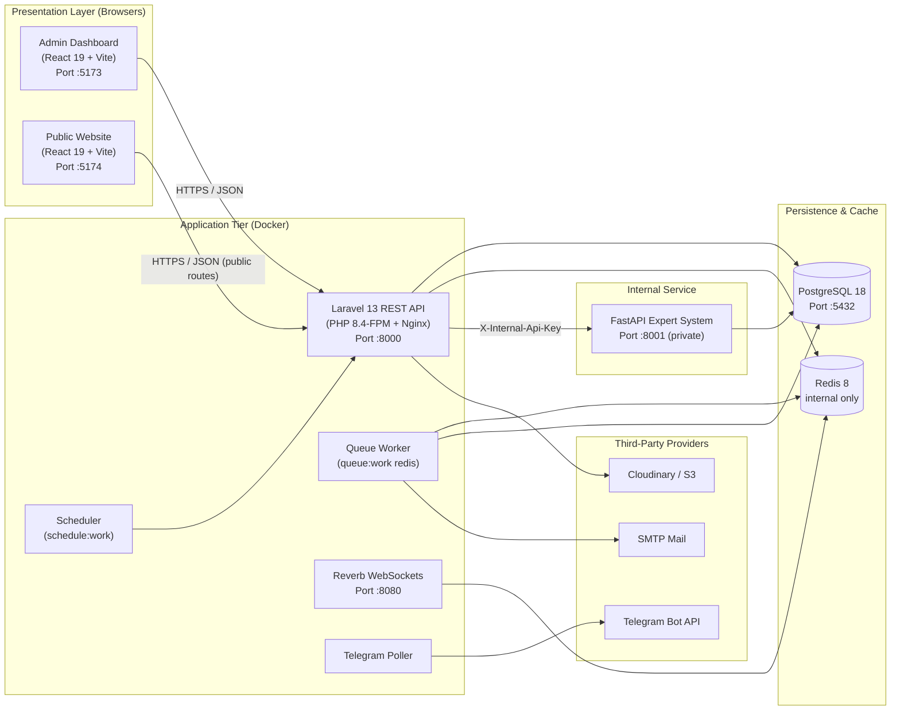

# RoyalCare — Clinic Management System & Medical Expert System

[](https://laravel.com)
[](https://react.dev)
[](https://vitejs.dev)
[](https://tailwindcss.com)
[](https://www.postgresql.org)
[](https://redis.io)
[](https://fastapi.tiangolo.com)
[](https://www.docker.com)

> **Deployment status**
>
> | Application | URL |
> | --- | --- |
> | **Admin dashboard** (React + Vite) | `http://localhost:5173` |
> | **Public website** (React + Vite) | `http://localhost:5174` |
> | **Backend REST API** (Laravel) | `http://localhost:8000/api/v1` |
> | **Expert system** (FastAPI, internal) | `http://expert-system:8001` |
>
> No production deployment has been performed or verified in this working copy.
> See [Section 10 · Deployment](docs/10-deployment/index.md).

A full-stack **clinic management platform** for RoyalCare Clinic. It combines an
internal staff dashboard, a public clinic website, a Laravel REST API, a
PostgreSQL database, and a Python clinical decision-support service, all
orchestrated with Docker Compose.

> **Ownership:** This is proprietary software owned by SanTin. It is **not** an
> open-source project. See [PROPRIETARY-NOTICE.md](PROPRIETARY-NOTICE.md) and the
> [full notice](#11-license) below.

---

## 1. System Architecture

The monorepo contains four cooperating applications plus shared infrastructure,
communicating over a versioned REST API (`/api/v1`).



Key architectural rules:

- Both SPAs call the Laravel API. The public website uses **only**
  unauthenticated, read-only `/website/*` endpoints plus `POST /website/contact`.
- The expert system has no published host port in the base Compose file.
- PostgreSQL is the only durable data store; Redis holds cache, sessions, and
  queues.
- The backend enforces authorization. UI guards are convenience only.

---

## 2. Technology Stack

| Layer | Technologies | Key Packages & Libraries |
| --- | --- | --- |
| **Backend API** | PHP 8.4 (image), Laravel 13 | Sanctum, spatie/laravel-permission, Reverb, Scramble, DomPDF, PHPUnit 12, Pint |
| **Admin Dashboard** | React 19, Vite, Tailwind CSS 4 | React Router 7, TanStack Query, Zustand, Zod, Axios, Sonner, shadcn/Base UI, Lucide, jsPDF, html2canvas-pro, qrcode.react, html5-qrcode |
| **Public Website** | React 19, Vite, Tailwind CSS 4 | React Router 7, TanStack Query, Axios, DOMPurify, Lucide |
| **Expert System** | Python 3.12, FastAPI 0.143, Uvicorn | SQLAlchemy 2.1, psycopg 3.3, Pydantic, pytest, httpx, Bandit, pip-audit |
| **Database** | PostgreSQL 18 | Read-only analytics views (`vw_*`), transactional stock and billing writes |
| **Cache & Queues** | Redis 8 Alpine | Session store, cache, rate limiting, Redis-backed queues |
| **Realtime** | Laravel Reverb 1.12 | WebSocket chat and notification broadcasts |
| **DevOps** | Docker Compose | 6 services (`backend`, `frontend`, `website`, `expert-system`, `postgres`, `redis`) |
| **CI** | GitHub Actions | Expert system only: pytest, Bandit, pip-audit |

---

## 3. Repository Structure

```text
clinic-management-medical-expert-system/
├── backend/                       # Laravel 13 REST API (/api/v1)
│   ├── app/
│   │   ├── Console/Commands/      # telegram:poll, attendance:finalize, alerts:generate, ...
│   │   ├── Events/  Listeners/  Jobs/
│   │   ├── Http/
│   │   │   ├── Controllers/Api/   # One controller per domain
│   │   │   ├── Middleware/        # account.active, step.up, 2fa.enrolled, device.trust, ...
│   │   │   └── Requests/          # Form-request validation
│   │   ├── Models/  Policies/  Providers/
│   │   └── Services/              # Auth, billing, inventory, inpatient, files, Telegram, website
│   ├── config/                    # auth.php, filesystems.php, services.php, ...
│   ├── database/
│   │   ├── data/knowledge_base_100/   # Starter knowledge base (CSV + JSON)
│   │   ├── migrations/                # Authoritative schema
│   │   └── seeders/                   # Roles, admin, demo data, website, knowledge base
│   ├── docker/                    # nginx.conf, php.ini, supervisord.conf, start scripts
│   ├── routes/                    # api.php, channels.php, console.php, web.php
│   ├── tests/                     # PHPUnit feature + unit suites
│   └── Dockerfile  composer.json  phpunit.xml
├── frontend/                      # Admin dashboard SPA (staff + website CMS)
│   ├── src/api/                   # Axios endpoint modules by feature
│   ├── src/components/            # UI primitives, layout, domain components
│   ├── src/pages/                 # Route screens
│   ├── src/router/                # Router, ProtectedRoute, permission Guard
│   ├── src/i18n/  styles/  utils/  hooks/
│   └── Dockerfile  package.json  vite.config.js
├── website/                       # Public website SPA (read-only)
│   ├── src/api/  components/  constants/  hooks/
│   ├── src/pages/public/          # Home, About, Services, Team, Gallery, News, Contact, legal
│   ├── public/media/              # Hero and stock imagery
│   └── Dockerfile  package.json
├── expert-system/                 # FastAPI clinical decision support
│   ├── app/                       # audit.py, config.py, database.py, engine.py, main.py, schemas.py
│   ├── postman/                   # Collection and guide
│   ├── tests/                     # pytest suite
│   └── Dockerfile  requirements.txt  requirements-dev.txt
├── docker/nginx/                  # Production TLS reverse-proxy example
├── docs/                          # Documentation (sections 01–11 + appendix)
├── .github/workflows/             # expert-system-ci.yml
├── docker-compose.yml             # 6 services
├── docker-compose.override.yml    # Development-only expert-system port
├── PROPRIETARY-NOTICE.md
└── README.md
```

---

## 4. Environment Variables

Copy each `.env.example` template to `.env` before starting the application. A
full annotated table lives in
[10 · Deployment §10.3](docs/10-deployment/index.md).

### 4.1 Root Compose variables (`.env`)

| Variable | Default | Purpose |
| --- | --- | --- |
| `POSTGRES_DB` | `clinic_db` | Database name |
| `POSTGRES_USER` | `clinic_user` | Database user |
| `POSTGRES_PASSWORD` | `change_me` | **Replace before use** |
| `POSTGRES_PORT` | `5432` | Host port for PostgreSQL |
| `BACKEND_PORT` | `8000` | Host port for the API |
| `FRONTEND_PORT` | `5173` | Host port for the admin dashboard |
| `WEBSITE_PORT` | `5174` | Host port for the public website |
| `REVERB_PORT` | `8080` | Host port for Reverb |
| `EXPERT_SYSTEM_URL` | `http://expert-system:8001` | Internal expert-system URL |
| `EXPERT_SYSTEM_TIMEOUT` | `15` | Laravel → expert-system timeout (s) |
| `EXPERT_SYSTEM_CONNECT_TIMEOUT` | `2` | Connect timeout (s) |
| `EXPERT_SYSTEM_API_KEY` | *(empty)* | Shared internal secret; set in production |
| `EXPERT_SYSTEM_LOG_LEVEL` | `INFO` | Log level |
| `EXPERT_RULES_CACHE_TTL_SECONDS` | `60` | Rule cache TTL; `0` disables |
| `EXPERT_SYSTEM_REQUEST_TIMEOUT_SECONDS` | `15` | Per-request timeout inside FastAPI |
| `EXPERT_AUDIT_ENABLED` | `false` | Store evaluation audits (privacy-sensitive) |

### 4.2 Backend variables (`backend/.env`)

| Variable | Example | Notes |
| --- | --- | --- |
| `APP_ENV` | `local` | `production` when deployed |
| `APP_KEY` | *(generate)* | `php artisan key:generate` |
| `APP_DEBUG` | `true` | `false` in production |
| `APP_URL` | `http://localhost:8000` | Public HTTPS URL in production |
| `DB_CONNECTION` | `pgsql` | Compose overrides host/user/password |
| `CACHE_STORE` | `redis` | Compose sets this |
| `QUEUE_CONNECTION` | `redis` | Compose sets this |
| `SESSION_DRIVER` | `redis` | Compose sets this |
| `SANCTUM_EXPIRATION` | `480` | Token lifetime in minutes |
| `CORS_ALLOWED_ORIGINS` | `http://localhost:5173,http://localhost:5174` | Exact origins only |
| `FRONTEND_URL` | `http://localhost:5173` | Admin dashboard URL |
| `AUTH_OTP_ENABLED` | `false` | Email OTP for untrusted devices |
| `AUTH_2FA_MANDATORY` | `false` | TOTP enforcement |
| `AUTH_LOCKOUT_ENABLED` | `false` | Progressive lockout |
| `AUTH_REQUIRE_VERIFIED_EMAIL` | `false` | Verification gate |
| `FILESYSTEM_DISK` | `local` | Private disk by default |
| `DOCUMENTS_DISK` | `local` | Patient/staff documents |
| `MAIL_*` | `smtp` | Use a working provider in production |
| `REVERB_APP_ID` / `REVERB_APP_KEY` / `REVERB_APP_SECRET` | *(empty)* | Required for realtime |
| `TELEGRAM_BOT_TOKEN` / `TELEGRAM_WEBHOOK_SECRET` | *(empty)* | Optional integration |

### 4.3 SPA variables (`frontend/.env`, `website/.env`)

| Variable | App | Default |
| --- | --- | --- |
| `VITE_API_URL` | Both | `http://localhost:8000/api/v1` |
| `VITE_PUBLIC_SITE_URL` | Admin | `http://localhost:5174` |
| `VITE_REVERB_APP_KEY` / `_HOST` / `_PORT` / `_SCHEME` | Admin | Must match backend |

`VITE_*` values are compiled into the browser bundle. Never put a secret in one.

---

## 5. Quick Start & Setup Instructions

### Prerequisites

- [Docker](https://www.docker.com/) and Docker Compose v2
- [Node.js](https://nodejs.org/) 22+ and `npm` (only for host-side SPA work)
- Git

Host PHP/Composer/Python are not required: the images already contain PHP 8.4,
Node 22, and Python 3.12.

### 1. Clone the repository

```bash
git clone <your-repository-url>
cd clinic-management-medical-expert-system
```

### 2. Configure environment files

```bash
# Root Compose values
cp .env.example .env

# Backend application values
cp backend/.env.example backend/.env

# SPA build values (only if running the SPAs on the host)
cp frontend/.env.example frontend/.env
cp website/.env.example website/.env
```

Set `POSTGRES_PASSWORD` in the root `.env`. Do not commit any `.env` file.

### 3. Launch Docker services

```bash
docker compose up -d --build
docker compose ps
```

Expected: `clinic_postgres`, `clinic_redis`, and `clinic_expert_system` report
`healthy`; `clinic_backend`, `clinic_frontend`, and `clinic_website` report `Up`.

API-tier only:

```bash
docker compose up -d --build backend expert-system postgres redis
```

### 4. Initialize the database (new, empty database only)

```bash
docker compose exec backend php artisan key:generate
docker compose exec backend php artisan migrate
docker compose exec backend php artisan db:seed
```

`db:seed` always creates roles/permissions, the administrator account, shift
templates, and baseline website content. In `local` and `testing` it also creates
demo users and demo clinic content.

> **Never** run `migrate:fresh`, `db:wipe`, or `docker compose down -v` against
> data you need to keep.

### 5. Open the applications

| Application | URL |
| --- | --- |
| Admin dashboard | [http://localhost:5173](http://localhost:5173) |
| Public website | [http://localhost:5174](http://localhost:5174) |
| API health | [http://localhost:8000/up](http://localhost:8000/up) |
| API docs (Scramble) | [http://localhost:8000/docs/api](http://localhost:8000/docs/api) |
| Expert system health (dev override) | [http://localhost:8001/health](http://localhost:8001/health) |

Sign in with the local administrator account created by
`backend/database/seeders/AdminUserSeeder.php`, then change its password
immediately.

### 6. Run the SPAs on the host instead

```bash
# Terminal 1 — admin dashboard
cd frontend && npm install && npm run dev

# Terminal 2 — public website
cd website && npm install && npm run dev
```

---

## 6. Seeded Accounts

`DatabaseSeeder` provisions roles, permissions, an administrator, and — in
`local`/`testing` only — demo staff and patient accounts.

| Seeder | Environment | Creates |
| --- | --- | --- |
| `RolePermissionSeeder` | All | The seven roles and every permission |
| `AdminUserSeeder` | All | The local administrator account |
| `ShiftTemplateSeeder` | All | Baseline shift templates |
| `WebsiteContentSeeder`, `LegalDocumentSeeder`, `AboutContentBlockSeeder`, `WebsitePageContentSeeder` | All | Baseline CMS content, including the bilingual legal documents |
| `DemoUsersSeeder` | `local`, `testing` | Demo staff and patient accounts |
| `KhmerDemoDataSeeder`, `QueueDemoSeeder`, `WardRoomBedDemoSeeder`, `InpatientDemoDataSeeder`, `WebsiteDemoContentSeeder` | `local`, `testing` | Demo clinic and website content |

The seven roles are **Admin**, **Receptionist**, **Nurse**, **Head Nurse**,
**Doctor**, **Pharmacist**, and **Patient**.

> [!WARNING]
> **Seeded passwords are intentionally not reproduced in this documentation.**
> Read them from `backend/database/seeders/AdminUserSeeder.php` and
> `DemoUsersSeeder.php` in a local checkout. All seeded accounts and default
> passwords **must** be changed or removed before any staging or production
> deployment.

---

## 7. Implementation Status Matrix

| Module / Capability | Status | Notes |
| --- | --- | --- |
| **Authentication & account security** | **Implemented** | Sanctum tokens, optional email OTP, optional TOTP 2FA, trusted devices, session/device revocation, password reset by code |
| **Staff invitations & approval** | **Implemented** | Hashed invitation tokens, approval queue, last-admin protection |
| **Role-based access control** | **Implemented** | 7 roles, fine-grained permissions, policies, step-up middleware |
| **Patients & documents** | **Implemented** | Private storage, authorized downloads, MIME/size validation, optional ClamAV |
| **Appointments & outpatient queue** | **Implemented** | Explicit queue transitions: call, start, complete, skip, cancel |
| **Clinical records** | **Implemented** | Vitals, consultations, diagnoses, medical records |
| **Prescriptions & dispensing** | **Implemented** | Batch allocation, stock movements, cancel/dispense actions |
| **Pharmacy catalog & inventory** | **Implemented** | Medicines, batches, expiry, stock movements, dashboard |
| **Pharmacy POS** | **Implemented** | Server-side pricing, required idempotency key, atomic sale + invoice + allocation |
| **POS void / refund** | **Not implemented** | Schema columns exist; no endpoint |
| **Supplier & stock-receipt purchasing** | **Proposed** | No `suppliers` or `stock_receipts` tables |
| **Billing & payments** | **Partially implemented** | Invoices, items, payments, PDFs, reports; **no external gateway** |
| **Inpatient care** | **Implemented** | Wards/rooms/beds, admissions, transfers, discharge, nursing tasks, MAR, inpatient billing |
| **Staff & HR** | **Implemented** | Directory, salaries, documents, leave, attendance (QR kiosk), shift scheduling |
| **Communication** | **Implemented** | Chat with Reverb, announcements, news, notifications, system alerts, Telegram |
| **Website CMS & public site** | **Implemented** | Settings, pages, services, team, gallery, articles, media, contact inbox; published-only public API |
| **Medical expert system** | **Implemented** | Deterministic rule matching; not a medical device |
| **Patient self-service portal** | **Not present** | `Patient` role exists; no separate portal. Operational use **Unverified** |
| **Automated backups & CI** | **Partially implemented** | Expert-system CI only; no backend/SPA workflows; no backup container |
| **Production deployment** | **Unverified** | Not performed in this working copy |

---

## 8. Testing & Quality Assurance

| Suite | Tool | Recorded result |
| --- | --- | --- |
| Backend API | PHPUnit 12 (in-memory SQLite) | **608 tests passed** |
| Expert system | pytest 8.4 + httpx | **45 tests passed** |
| Admin dashboard | Oxlint + Vite build | Lint exit `0` (warnings only); build passed |
| Public website | Oxlint + Vite build | Lint exit `0` (warnings only); build passed |
| Expert static analysis | Bandit + pip-audit | Passed in CI |
| Compose configuration | `docker compose config --quiet` | Valid |

```bash
# Backend
cd backend && composer test

# Expert system
cd expert-system && python -m pytest -q

# Frontends
cd frontend && npm run lint && npm run build
cd ../website && npm run lint && npm run build
```

The suite was **not** re-run while this documentation set was written; the
numbers above are a snapshot from this working copy. Only the expert system has
CI. See [09 · Testing](docs/09-testing/index.md) for the full inventory and known
gaps.

Known non-blocking warnings:

- React Compiler lint advisories in both SPAs (`set-state-in-effect`,
  `only-export-components`, missing effect dependencies).
- A Starlette/httpx deprecation warning in the expert-system suite.
- `npm audit` reports advisories in the `shadcn` CLI dev toolchain, which is not
  shipped in production bundles.

---

## 9. Screenshots

Screenshots are not committed yet. Drop images into
[`docs/screenshots/`](docs/screenshots/) (tracked with `.gitkeep`) and reference
them here.

| Area | Suggested capture |
| --- | --- |
| Dashboard | Analytics cards and charts |
| Patient record | Demographics, documents, clinical tabs |
| Pharmacy POS | Cart with server-calculated totals |
| Inpatient billing | Admission ledger and reconciliation |
| Website CMS | Page editor with publish control |
| Public website | Home page (EN and KM) |

---

## 10. Complete Documentation Index

Full technical documentation lives in [`/docs`](docs/README.md), organized as
eleven numbered sections plus an appendix:

- [**01 · Project Overview**](docs/01-project-overview/index.md): problem statement, objectives, scope, roles, architecture, stack, feature map, honest status summary, repository structure.
- [**02 · Requirements**](docs/02-requirements/index.md): stakeholders, assumptions, FR-A–FR-M, role–permission matrix, non-functional requirements, acceptance criteria.
- [**03 · System Analysis**](docs/03-system-analysis/index.md): existing-system problems, proposed system, actor profiles, use cases, activity diagrams, business rules.
- [**04 · System Design**](docs/04-system-design/index.md): architecture, backend layers, SPA design, API standards, auth and authorization, sequence diagrams, security.
- [**05 · Database Design**](docs/05-database-design/index.md): ERD, table inventory by domain, views, indexes, seeders, backup rules.
- [**06 · Features**](docs/06-features/index.md): feature-by-feature specification with status labels and limits.
- [**07 · API Documentation**](docs/07-api-documentation/index.md): base URL, headers, status codes, full route inventory, internal expert API, error examples.
- [**08 · Frontend Documentation**](docs/08-frontend-documentation/index.md): admin SPA and public website routes, state, API modules, design system, build notes.
- [**09 · Testing**](docs/09-testing/index.md): test strategy, backend and expert-system suites, frontend checks, CI, quality gates.
- [**10 · Deployment**](docs/10-deployment/index.md): Compose topology, environment variables, TLS, release sequence, backups, rollback, production checklist.
- [**11 · User Guide**](docs/11-user-guide/index.md): step-by-step workflows for each role, plus the public visitor path.

Appendix:

- [Administrator Security Runbook](docs/ADMIN_SECURITY_RUNBOOK.md): invitations, approval, 2FA, step-up, lockout, and rollout sequencing.
- [Production TLS proxy notes](docker/nginx/README.md): Nginx TLS termination example.
- [Documentation index](docs/README.md): reading order and conventions.

App-specific guides:

- [Backend README](backend/README.md)
- [Admin dashboard README](frontend/README.md)
- [Public website README](website/README.md)
- [Expert system README](expert-system/README.md)
- [Postman collection guide](expert-system/postman/README.md)

---

## 11. License

# Copyright (c) 2026 SanTin. All Rights Reserved.

The complete notice is also available in
[PROPRIETARY-NOTICE.md](PROPRIETARY-NOTICE.md).

**PROPRIETARY SOFTWARE & COPYRIGHT NOTICE**

Copyright © 2026 SanTin. All Rights Reserved.

This project and all associated materials—including but not limited to source
code, software architecture, UI/UX design, visual assets, documentation, and
other original components—are the intellectual property of SanTin, except where
otherwise stated. All rights to the original materials contained in this project
are expressly reserved by the copyright holder.

This repository is provided for viewing, reference, and personal educational
study only. Public availability does not constitute a license, transfer of
ownership, or authorization to use, reproduce, modify, or distribute any part of
this project.

You may access this repository to:

- View and study the source code for personal educational purposes.
- Learn from the implementation, architecture, and development techniques.
- Reference the project for non-commercial learning without reproducing
  substantial portions of its original materials.

These permissions do not grant the right to reuse or redistribute the project's
original work.

Without prior explicit written permission from SanTin, you are strictly
prohibited from:

- **Reproducing** — copying or incorporating substantial portions of the source
  code, design, assets, or other original materials into another project.
- **Redistributing** — re-uploading, publishing, sharing, sublicensing, or
  distributing this project or substantial portions of it.
- **Misrepresenting authorship** — claiming, implying, or presenting this
  project or its original work as your own.
- **Unauthorized modification and publication** — modifying and publishing
  derivative versions or forks that reproduce substantial portions of the
  protected materials.
- **Commercial exploitation** — selling, licensing, monetizing, or commercially
  using this project or substantial portions of its original materials.
- **Removing attribution** — removing, concealing, or altering copyright
  notices or ownership attributions included with the project.
- **Academic or professional misrepresentation** — submitting this project, or
  substantial portions of its original work, as your own independently created
  work.

Any use beyond the expressly permitted educational viewing and study requires
prior written authorization from SanTin.

Permission requests should clearly identify the intended use, the materials
involved, and whether the proposed use is commercial or non-commercial.

No permission, license, or other rights are granted by implication, estoppel, or
the mere act of making this repository publicly accessible. Unauthorized
reproduction, distribution, commercial exploitation, or misrepresentation of
protected materials may constitute copyright infringement or other violations of
applicable law.

The copyright holder reserves all rights and remedies available under applicable
law, including the right to request removal of unauthorized copies and pursue
appropriate legal remedies where warranted.

**PUBLICLY ACCESSIBLE DOES NOT MEAN FREE TO REUSE.**

Respect the creator. Respect the intellectual property. Give credit where it is
due—but understand that attribution alone does not replace permission.

This project represents original work, development time, technical decisions,
and creative effort. Its availability for learning must not be interpreted as
consent to appropriate, reproduce, or exploit that work.

Copyright © 2026 SanTin. All Rights Reserved.

Unauthorized use is not authorized simply because the source code is visible.

### Third-party components

This project uses third-party frameworks, libraries, container images, and
assets. Their own licenses and terms continue to apply:

- Laravel, React, Vite, Tailwind CSS, FastAPI, PostgreSQL, and Redis are
  third-party open-source projects.
- The Pexels stock photo listed in [website/README.md](website/README.md) is
  covered by the Pexels License, not by this project's notice.
- `backend/composer.json` contains Laravel skeleton metadata, including an
  inherited `license` field. That metadata does not make this project
  open-source and does not override this notice.

Do not remove third-party copyright or license notices.
