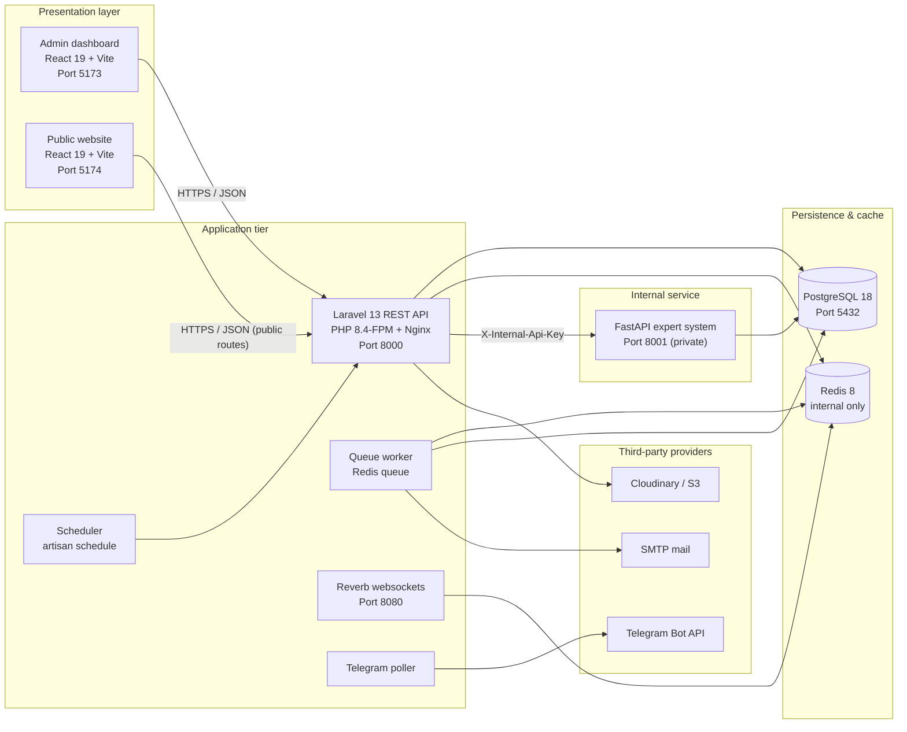

# 01 · Project Overview

## 1.1 Introduction

The **RoyalCare Clinic Management System & Medical Expert System** is a full-stack
web platform for a clinic. It combines an internal staff dashboard, a public
informational website, a Laravel REST API, a PostgreSQL database, and a Python
clinical decision-support service.

The monorepo contains four cooperating applications:

| Application | Path | Audience | Purpose |
| --- | --- | --- | --- |
| **Backend API** | `backend/` | Server | Laravel REST API (`/api/v1`) that owns data, business logic, authentication, and access control |
| **Admin dashboard** | `frontend/` | Clinic staff and administrators | Patients, appointments, clinical records, prescriptions, pharmacy POS, billing, inpatient care, HR, communication, audit, and website CMS |
| **Public website** | `website/` | Public visitors | Public, read-only clinic website: services, team, gallery, news, CMS pages, contact form |
| **Expert system** | `expert-system/` | Internal service | Deterministic rule-based clinical decision support, called only by Laravel |

Supporting infrastructure:

- `docker-compose.yml` runs `backend`, `frontend`, `website`, `expert-system`,
  `postgres`, and `redis` on a private `clinic` network.
- `docker/nginx/` holds a production TLS reverse-proxy example.
- `.github/workflows/expert-system-ci.yml` runs the Python test suite, Bandit,
  and pip-audit.

> **Proprietary software.** This project is not open source. See
> [PROPRIETARY-NOTICE.md](../../PROPRIETARY-NOTICE.md).

## 1.2 Problem Statement

Small and medium clinics commonly run on paper files spread across reception,
consultation rooms, the pharmacy, and the cashier. That creates predictable
problems:

- Patient history, appointments, and prescriptions live in different places.
- Stock is counted manually, so expiry and low-stock risks are discovered late.
- Billing is reconstructed after the fact, and inpatient charges are easy to
  miss.
- Staff scheduling, attendance, and leave are tracked in spreadsheets.
- There is no audit trail for sensitive actions or clinical record changes.
- The clinic has no controlled public web presence, and content changes require
  a developer.

This system centralizes those workflows into one permission-controlled
application with an auditable backend.

## 1.3 Objectives

1. Provide a single, permission-controlled record for patients, appointments,
   clinical encounters, prescriptions, and billing.
2. Enforce a dispensary workflow with batch-level stock allocation and stock
   movements.
3. Support inpatient admissions, bed management, nursing tasks, medication
   administration, and inpatient billing.
4. Give administrators staff lifecycle tools: invitations, approval, roles,
   suspension, step-up authorization, and audit logs.
5. Provide a public website whose content is managed by clinic staff, not by
   code changes.
6. Offer an explainable, rule-based expert system that surfaces matching rules
   and supporting evidence without claiming to diagnose.
7. Run locally and in production with Docker, PostgreSQL, Redis, and a private
   Python service.

## 1.4 Scope

### In scope (current build)

- Authentication: password login, optional email OTP, optional TOTP 2FA, staff
  invitations, email verification, password reset by code, trusted devices,
  session and device management, step-up authorization, optional lockout.
- Patients and documents, with private file storage and signed downloads.
- Appointments and an outpatient queue.
- Clinical records: consultations, diagnoses, vital signs, medical records.
- Prescriptions and pharmacy dispensing.
- Medicine catalog, inventory batches, stock movements, pharmacy dashboard, and
  point-of-sale checkout.
- Billing: invoices, invoice items, payments, PDF invoices, reports.
- Inpatient care: wards, rooms, beds, admissions, transfers, discharge, nursing
  tasks, nurse assignments, medication administration records, inpatient billing.
- Staff directory, departments, job titles, salaries, documents, leave,
  attendance with rotating QR sessions, and shift scheduling.
- Communication: direct/group chat, announcements, news, notifications,
  system alerts, Telegram linking.
- Admin dashboard analytics, audit logs, and reports.
- Website CMS: settings, pages, services, team, gallery, articles, media,
  content blocks, and a contact inbox.
- Public read-only website endpoints and a contact form.
- Internal expert-system evaluation with an optional audit trail.

### Out of scope (current build)

- A separate patient self-service portal. A `Patient` role exists and can sign in
  to the same dashboard with a restricted permission set; whether real patients
  use it operationally is **Unverified**.
- Live payment gateways. Payments are recorded; no external processor is called.
- Supplier management and purchase/stock-receipt receiving. These are proposed
  only; see [06 · Features](../06-features/index.md).
- Telemedicine, e-prescription transmission, SMS, insurance claim clearing, and
  laboratory/radiology integrations.
- Mobile or offline applications.
- Clinically validated diagnosis or triage. The expert system is deterministic
  rule matching, not a medical device.

## 1.5 Target Users and Roles

| Role | Intended user | Typical capabilities |
| --- | --- | --- |
| **Admin** | System administrator | Every permission; user lifecycle, security, system health, website CMS, knowledge base, audit logs |
| **Receptionist** | Front desk | Patient registration, appointments, queue, billing, inpatient view and billing |
| **Nurse** | Ward/outpatient nurse | Vitals, medical records, nursing tasks, medication administration, assignments, documents |
| **Head Nurse** | Nursing supervisor | Nursing operations plus wards/beds, assignments, attendance management, announcements, leave approval |
| **Doctor** | Physician | Consultations, diagnoses, medical records, prescriptions, expert system, admissions |
| **Pharmacist** | Dispensary | Medicines, inventory, prescription dispensing, pharmacy POS |
| **Patient** | Patient account | Own patient record, appointments, medical records, prescriptions, announcements (read-only web access) |

The authoritative role → permission mapping is
`backend/database/seeders/RolePermissionSeeder.php`. It is reproduced in
[02 · Requirements](../02-requirements/index.md).

## 1.6 High-Level Architecture



Notes:

- Both SPAs call the Laravel API; the public website uses only unauthenticated,
  read-only `/website/*` endpoints plus `POST /website/contact`.
- The expert system has no public host port in the base Compose file. Only the
  development override maps `127.0.0.1:8001`.
- Redis backs cache, sessions, and queues in Compose. PostgreSQL is the only
  durable data store.
- Files are stored on a private disk by default, with Cloudinary/S3 configuration
  available for documents and website media.

## 1.7 Technology Stack

| Layer | Technology | Notes |
| --- | --- | --- |
| **Backend language** | PHP `^8.3`; image uses PHP 8.4 | Laravel API |
| **Backend framework** | Laravel `^13.17` | API routes under `/api/v1` |
| **Authentication** | Laravel Sanctum `^4.0` | Bearer tokens |
| **Authorization** | `spatie/laravel-permission` `^8.3` | Roles + fine-grained permissions |
| **Realtime** | Laravel Reverb `^1.12` | WebSockets on `8080` |
| **API docs** | Dedoc Scramble `^0.13.47` | `/docs/api`, `/docs/api.json` |
| **PDF** | `barryvdh/laravel-dompdf` `^3.1` | Invoice PDFs |
| **Database** | PostgreSQL 18 | Container `postgres:18` |
| **Cache / queue / session** | Redis 8 | `redis:8-alpine` |
| **Admin SPA** | React 19, Vite, JavaScript/JSX | `frontend/` |
| **Public SPA** | React 19, Vite, JavaScript/JSX | `website/` |
| **Routing** | React Router v7 | Both SPAs |
| **Server state** | TanStack Query | Both SPAs |
| **Client state** | Zustand | Admin SPA |
| **Styling** | Tailwind CSS v4, shadcn / Base UI | Both SPAs |
| **Validation** | Zod | Admin SPA forms |
| **Lint** | Oxlint | Both SPAs |
| **Export** | html2canvas-pro, jsPDF, qrcode.react | Admin SPA |
| **Expert system** | Python 3.12, FastAPI 0.143, Uvicorn 0.38 | `expert-system/` |
| **Expert data access** | SQLAlchemy 2.1.4, psycopg 3.3.6 | Parameterized SQL |
| **Backend tests** | PHPUnit `^12.5.12` | In-memory SQLite |
| **Expert tests** | pytest 8.4.2, httpx 0.28.1 | In-memory SQLite |
| **Security scanning** | Bandit, pip-audit | CI |
| **Orchestration** | Docker Compose | 6 services |
| **CI** | GitHub Actions | Expert system only |
| **Code style** | Laravel Pint | Backend |

## 1.8 Feature Map

| Module | Primary screens/routes | Sub-system | Status |
| --- | --- | --- | --- |
| Authentication & account security | `/login`, `/login/verify`, `/login/2fa`, `/settings` | Backend + admin SPA | Implemented |
| Users, invitations, approvals | `/users`, `/invitations`, `/approvals` | Backend + admin SPA | Implemented |
| Patients & documents | `/patients`, `/patients/:id` | Backend + admin SPA | Implemented |
| Appointments | `/appointments`, `/appointments/:id` | Backend + admin SPA | Implemented |
| Outpatient queue | `/queue` | Backend + admin SPA | Implemented |
| Clinical records | `/medical-records` | Backend + admin SPA | Implemented |
| Prescriptions | `/prescriptions`, `/prescriptions/:id` | Backend + admin SPA | Implemented |
| Pharmacy catalog & inventory | `/pharmacy`, `/inventory` | Backend + admin SPA | Implemented |
| Pharmacy POS | `/pharmacy/pos` | Backend + admin SPA | Implemented (no void/refund endpoint) |
| Billing & payments | `/billing`, `/billing/:id` | Backend + admin SPA | Implemented (recorded payments only) |
| Inpatient care | `/wards`, `/admissions`, `/admissions/:id/billing`, `/nursing-tasks`, `/mar`, `/assignments` | Backend + admin SPA | Implemented |
| Staff & HR | `/staff`, `/attendance`, `/scheduling`, `/leave` | Backend + admin SPA | Implemented |
| Communication | `/chat`, `/news`, `/announcements`, `/notifications` | Backend + admin SPA | Implemented |
| Audit & system health | `/audit-logs`, dashboard alerts | Backend + admin SPA | Implemented |
| Reports | `/reports` | Backend + admin SPA | Implemented |
| Website CMS | `/website/*` | Backend + admin SPA | Implemented |
| Public website | `website/` routes | Backend + public SPA | Implemented |
| Expert system | `/expert-system` | Backend + FastAPI + admin SPA | Implemented |
| Suppliers & stock receiving | — | — | **Proposed only** |
| Patient self-service portal | — | — | **Not implemented as a separate app** |

## 1.9 Implementation Status — Honest Summary

### Implemented

- Sanctum bearer-token authentication with optional email OTP, optional TOTP
  2FA, trusted devices, session/device revocation, and password reset by code.
- Staff invitations, approval queue, account suspension/disable, and last-admin
  protection.
- Role and permission enforcement on the backend, mirrored by UI guards.
- Patient records, documents, appointments, outpatient queue, consultations,
  diagnoses, vitals, and medical records.
- Prescriptions with dispense and cancel actions.
- Medicine catalog, batch inventory, stock movements, pharmacy dashboard, and
  POS checkout with server-side pricing and idempotency.
- Invoice creation, payments, PDF invoices, cancellation, and reports.
- Inpatient wards/rooms/beds, admissions, transfers, discharge, nursing tasks,
  nurse assignments, MAR, and inpatient billing.
- Staff directory, salaries, documents, leave, attendance (manual clock and
  rotating QR kiosk), and shift scheduling.
- Chat, announcements, news, notifications, system alerts, and Telegram
  integration.
- Website CMS and public website.
- Rule-based expert system with an optional audit trail.

### Partially implemented / limitations

- **Pharmacy POS has no void or refund endpoint**, although `pharmacy_sales`
  contains status and void columns.
- **POS checkout does not yet link a prescription**; prescription-required
  medicines are blocked from walk-in sale.
- **Payments are recorded, not processed.** No external gateway is called.
- **No supplier or stock-receipt workflow.** Inventory batches are created
  manually or by stock movement.
- **No patient-facing portal.** The `Patient` role can authenticate, but the
  clinic dashboard is the only UI.
- **Email verification, OTP login, 2FA enforcement, and lockout are disabled by
  default** and must be enabled per environment.
- **Website demo content** (hero statistics, partner names, stock photography) is
  not verified clinic data.
- **The base Compose stack is development-oriented**: bind-mounted source,
  `APP_ENV=local`, published database port, and Vite dev servers.
- **Production deployment has not been verified in this working copy.**

### Planned / future work

- Supplier records, stock receipts, and purchase-cost reporting.
- POS void/refund and prescription-linked sales.
- Real payment gateway integration.
- Patient self-service portal, if required.
- Automated clinical validation of the knowledge base.

> **Status-label convention:** **Implemented** = present in the running system;
> **Partially implemented** = present with the stated caveat; **Proposed** =
> designed or intended but absent from the codebase; **Unverified** = cannot be
> confirmed from this working copy.

## 1.10 Repository Structure

```text
clinic-management-medical-expert-system/
├── backend/                       # Laravel 13 REST API (/api/v1)
│   ├── app/
│   │   ├── Console/Commands/      # telegram:poll, attendance:finalize, alerts:generate, ...
│   │   ├── Events/  Listeners/  Jobs/
│   │   ├── Http/
│   │   │   ├── Controllers/Api/   # One controller per domain
│   │   │   ├── Middleware/        # account.active, password.current, device.trust, 2fa.enrolled, step.up, ...
│   │   │   └── Requests/          # Form request validation
│   │   ├── Models/                # Eloquent models
│   │   ├── Policies/              # Model authorization
│   │   ├── Providers/             # Rate limiters and gates
│   │   └── Services/              # Auth, billing, inventory, pharmacy, files, Telegram, website
│   ├── config/                    # auth.php, filesystems.php, services.php, ...
│   ├── database/
│   │   ├── data/knowledge_base_100/  # Starter knowledge base (CSV + JSON)
│   │   ├── migrations/
│   │   └── seeders/               # Roles, admin, demo data, website, knowledge base
│   ├── docker/                    # nginx.conf, php.ini, supervisord.conf, warmup/start scripts
│   ├── routes/
│   │   ├── api.php                # Source of truth for 07 · API Documentation
│   │   ├── channels.php  console.php  web.php
│   ├── tests/                     # PHPUnit unit + feature tests
│   ├── Dockerfile  composer.json  phpunit.xml
├── frontend/                      # Admin dashboard SPA
│   ├── src/
│   │   ├── api/                   # Axios endpoint modules by feature
│   │   ├── components/            # UI, layout, and domain components
│   │   ├── constants/             # App name, navigation, roles
│   │   ├── context/               # Auth provider
│   │   ├── pages/                 # Route screens, including website CMS
│   │   ├── router/                # Router, ProtectedRoute, permission Guard
│   │   ├── styles/  utils/  hooks/
│   │   └── main.jsx
│   ├── Dockerfile  package.json  vite.config.js
├── website/                       # Public website SPA
│   ├── src/
│   │   ├── api/  components/  constants/  hooks/
│   │   ├── pages/public/          # Home, About, Services, Team, Gallery, News, Contact, legal pages
│   │   └── router/
│   ├── public/media/              # Hero and stock imagery
│   ├── Dockerfile  package.json
├── expert-system/                 # FastAPI clinical decision support
│   ├── app/
│   │   ├── audit.py  config.py  database.py  engine.py
│   │   ├── logging_config.py  main.py  schemas.py
│   ├── postman/                   # Collection and guide
│   ├── tests/
│   ├── Dockerfile  requirements.txt  requirements-dev.txt
├── docker/nginx/                  # clinic.conf.example + TLS proxy notes
├── docs/                          # This documentation set (01–11)
├── .github/workflows/             # expert-system-ci.yml
├── docker-compose.yml             # 6 services
├── docker-compose.override.yml    # Development-only expert-system port
├── PROPRIETARY-NOTICE.md
└── README.md
```

## 1.11 Documentation Map

| Section | Folder | Contents |
| --- | --- | --- |
| 01 | `docs/01-project-overview/` | This document |
| 02 | `docs/02-requirements/` | Stakeholders, functional and non-functional requirements, role–permission matrix |
| 03 | `docs/03-system-analysis/` | Actors, use cases, workflows, business rules |
| 04 | `docs/04-system-design/` | Architecture, layers, sequence flows, security design |
| 05 | `docs/05-database-design/` | ERD, table inventory, constraints, views, seeders |
| 06 | `docs/06-features/` | Feature-by-feature specifications and limits |
| 07 | `docs/07-api-documentation/` | Route inventory, auth, errors, examples |
| 08 | `docs/08-frontend-documentation/` | Admin and public SPA routes, state, modules, design system |
| 09 | `docs/09-testing/` | Test strategy, executed inventory, quality gates |
| 10 | `docs/10-deployment/` | Topology, environment, build, migrations, backups, rollback |
| 11 | `docs/11-user-guide/` | Step-by-step staff and patient-role guidance |
| Appendix | `docs/ADMIN_SECURITY_RUNBOOK.md` | Operational security hardening and rollout runbook |

The root [`README.md`](../../README.md) summarizes the project and links here.
