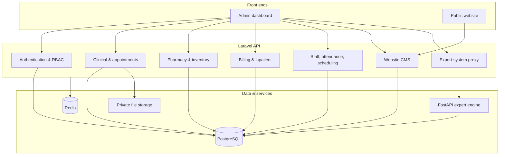
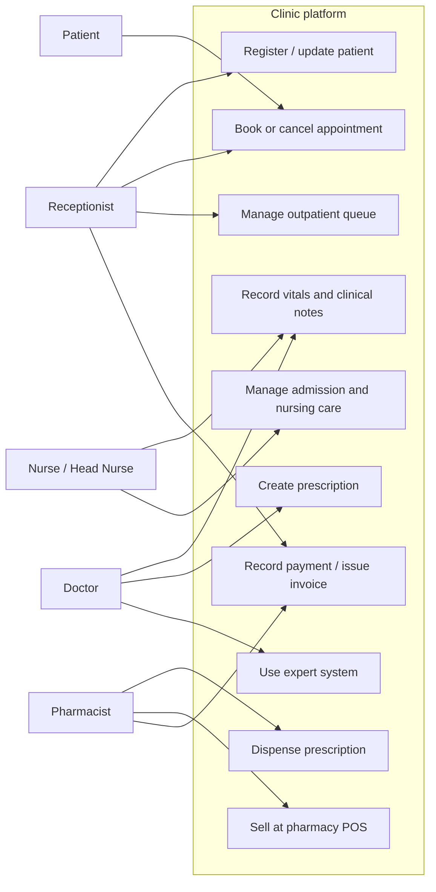
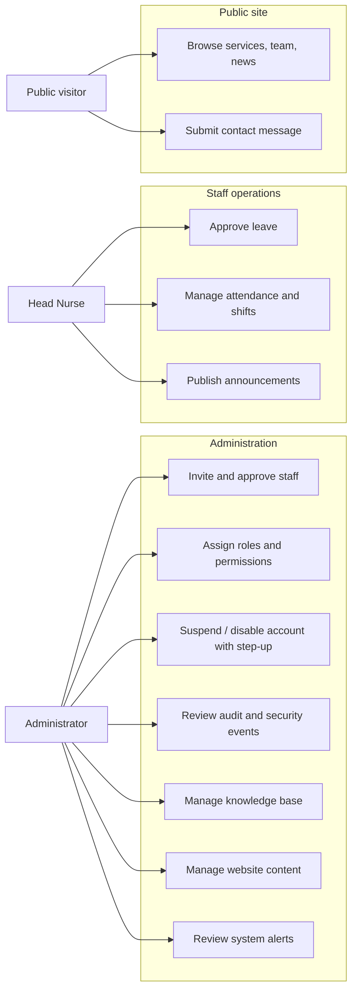
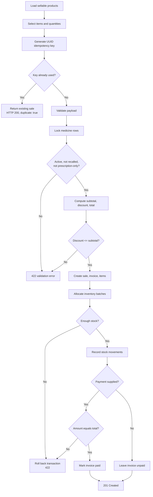
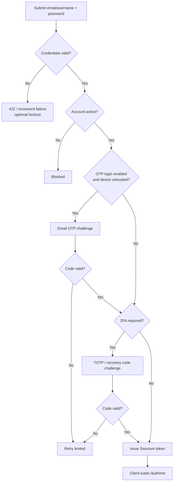
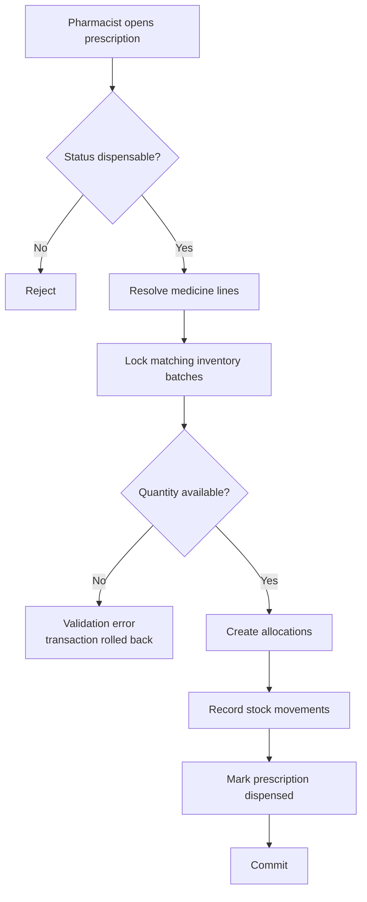

# 03 · System Analysis

## 3.1 Existing System and Problem Analysis

### 3.1.1 Current operational environment

Before centralization, a clinic of this size typically operates with:

- Paper patient folders and separate appointment books per desk.
- Prescriptions written by hand and dispensed from a stock cupboard.
- Cash receipts and invoices assembled at the end of the day.
- Spreadsheets for staff rosters, attendance, and leave.
- A brochure website updated by an external developer.
- No consistent audit trail for record edits or stock adjustments.

### 3.1.2 Identified problems and deficiencies

| Problem | Operational effect |
| --- | --- |
| Fragmented patient data | Staff repeat questions; allergies and history can be missed |
| Manual stock counts | Expiry and stock-out risks are found late; dispensing is not traceable |
| Late billing reconciliation | Missed charges, disputed balances, slow discharge |
| No role separation | Staff can see or change data outside their responsibility |
| No audit trail | Sensitive actions cannot be reviewed after the fact |
| No queue visibility | Patients wait without a predictable call order |
| Website depends on developers | Content changes are slow and expensive |

## 3.2 Proposed System

The proposed system replaces those workflows with one permission-controlled
platform:

### Key value propositions

- One patient record from registration through consultation, dispensing,
  billing, and inpatient stay.
- Transactional stock control with batch allocation instead of manual counts.
- Fine-grained authorization plus a user-visible audit trail.
- Staff self-service for attendance and leave, with supervisor approval.
- Website content managed by clinic staff.
- Deterministic, explainable expert-system matching, with a safety disclaimer.

## 3.3 User Roles and Actor Profiles

| Actor | Goals | Constraints |
| --- | --- | --- |
| **Administrator** | Keep the system secure and correctly configured | Cannot suspend/disable the last active administrator; sensitive actions need step-up |
| **Receptionist** | Register patients, book appointments, manage the queue, raise invoices | No clinical write access, no pharmacy stock access |
| **Nurse** | Record vitals, update records, execute nursing tasks and MAR | Cannot prescribe or dispense |
| **Head Nurse** | Supervise wards, assignments, attendance, announcements, leave | Cannot prescribe or manage the medicine catalog |
| **Doctor** | Consult, diagnose, prescribe, use the expert system | Cannot manage inventory, billing, or users |
| **Pharmacist** | Maintain medicines and stock, dispense, sell at POS | Cannot prescribe or edit clinical notes |
| **Patient** | View own record, manage appointments, view prescriptions | No staff workflows; no separate portal |
| **Public visitor** | Read clinic information and submit a contact message | Read-only public endpoints; contact form throttled |
| **Scheduler / system** | Finalize attendance, publish announcements, notify overdue tasks, generate alerts | Runs as a background process; must be idempotent |
| **Expert service** | Match active rules against symptom IDs | Internal only; shared API key; deterministic output |

## 3.4 Use Case Models

### 3.4.1 Clinical and front-desk use cases

### 3.4.2 Administration and content use cases

## 3.5 Detailed Use Case Specifications

### UC-01: Sign in with optional second factor

| Field | Detail |
| --- | --- |
| Actors | Staff user, Patient |
| Trigger | User submits credentials at `/login` |
| Preconditions | Account exists and is `active`; not locked |
| Main flow | 1. API validates email/username and password. 2. If OTP login is enabled and the device is untrusted, issue a challenge and email a code. 3. If 2FA is required, issue a TOTP challenge. 4. On success, issue a Sanctum token. 5. SPA stores the token and loads `/auth/me`. |
| Alternate flows | Invalid credentials → `422`; locked account → `429`; unverified email when enforcement is on → blocked by `verified`; missing 2FA enrollment → blocked by `2fa.enrolled` |
| Postconditions | Token issued; trusted-device cookie set when applicable; security event recorded |

### UC-02: Register a patient and book an appointment

| Field | Detail |
| --- | --- |
| Actors | Receptionist, Patient |
| Preconditions | `patients.create` / `appointments.create` permission |
| Main flow | 1. Create or select a patient. 2. Create an appointment with clinician, date, and time. 3. Optionally add the patient to the outpatient queue. 4. Queue staff call, start, and complete the visit. |
| Alternate flows | Validation failure → `422`; appointment cancelled → `cancel` action; queue entry skipped or cancelled |
| Postconditions | Patient and appointment persisted; queue state reflects the visit |

### UC-03: Consultation and prescription

| Field | Detail |
| --- | --- |
| Actors | Doctor |
| Preconditions | `consultations.create`, `diagnoses.create`, `prescriptions.create` |
| Main flow | 1. Open the patient record. 2. Record vitals if needed. 3. Create a consultation and diagnosis. 4. Optionally evaluate the expert system. 5. Create a prescription with medicine lines and dosage instructions. 6. Save the medical record. |
| Alternate flows | Missing clinical record → create one; expert system unavailable → `503`/`504`, consultation can continue |
| Postconditions | Consultation, diagnosis, prescription, and medical record are stored and auditable |

### UC-04: Dispense a prescription

| Field | Detail |
| --- | --- |
| Actors | Pharmacist |
| Preconditions | `prescriptions.update`, `inventory.manage` |
| Main flow | 1. Open the prescription. 2. Confirm items and available batches. 3. Dispense. 4. The service allocates stock, records movements, and updates the prescription state. |
| Alternate flows | Insufficient stock → validation error; already dispensed/cancelled → rejected by controller/policy |
| Postconditions | Stock reduced; prescription marked dispensed; movement history recorded |

### UC-05: Pharmacy POS checkout

| Field | Detail |
| --- | --- |
| Actors | Pharmacist, Admin |
| Preconditions | POS migrations applied; `PharmacySale` create policy passes |
| Main flow | 1. Load `/pharmacy/pos/products`. 2. Select medicines and quantities. 3. Send `idempotency_key`, optional patient, optional discount, optional payment, items. 4. Server validates and locks medicine rows. 5. Server computes totals, creates sale + invoice + items + allocations + stock movements. 6. Optionally records a payment equal to the total. 7. Return `201`. |
| Alternate flows | Duplicate key → `200` with `duplicate: true`; inactive/recalled/prescription-only medicine → `422`; insufficient stock → `422`; missing table → `503` |
| Postconditions | Sale and invoice persisted; stock reduced; response includes allocations |

### UC-06: Admit, care for, and discharge an inpatient

| Field | Detail |
| --- | --- |
| Actors | Doctor, Receptionist, Nurse, Head Nurse |
| Preconditions | Ward/room/bed exist; `admissions.create` |
| Main flow | 1. Create an admission with a bed. 2. Assign nurses. 3. Generate room charges and ad-hoc charges. 4. Record nursing tasks and medication administration. 5. Record payments or daily invoices. 6. Transfer the patient if needed. 7. Reconcile billing and discharge. |
| Alternate flows | Bed unavailable → validation error; transfer → bed status changes; cancellation before discharge |
| Postconditions | Admission closed; bed released; billing ledger reconciled |

### UC-07: Expert-system evaluation

| Field | Detail |
| --- | --- |
| Actors | Doctor, Admin |
| Preconditions | `expert-system.use`; Python service healthy |
| Main flow | 1. Select symptoms. 2. SPA calls `POST /api/v1/expert-system/evaluate`. 3. Laravel validates and forwards symptom IDs with the internal API key. 4. FastAPI loads active rules (cached), matches conditions, orders by priority. 5. Results return through Laravel. |
| Alternate flows | Unknown/inactive symptom or empty body → `422`; service down → `503`; timeout → `504` |
| Postconditions | Optional audit row written when `EXPERT_AUDIT_ENABLED=true` |

### UC-08: Publish website content

| Field | Detail |
| --- | --- |
| Actors | Administrator |
| Preconditions | `website.*` permissions |
| Main flow | 1. Edit page, article, service, team profile, gallery item, or content block. 2. Upload media. 3. Publish. 4. The public website fetches only published content. |
| Alternate flows | Unpublish removes content from public responses; media deletion removes references |
| Postconditions | Public site reflects the change without a code deployment |

## 3.6 Activity Diagrams for Core Workflows

### 3.6.1 POS checkout

### 3.6.2 Authentication and second factor

### 3.6.3 Prescription dispensing

## 3.7 Core Business Rules and Decision Logic

| Rule | Source of truth |
| --- | --- |
| Login is limited to 5 attempts per minute per email + IP; lockout is an optional additional control | `AppServiceProvider`, `config/auth.php` |
| Sensitive account actions require a step-up grant | `step.up` middleware on suspend/disable/approve routes |
| The last active administrator cannot be suspended or disabled | User policy / service |
| A POS sale requires a UUID idempotency key and at least one item | `PharmacyPosController::store` |
| Duplicate POS idempotency returns the original sale with HTTP `200` | `PharmacyPosController::store` |
| POS prices and totals are server-side; a discount cannot exceed the subtotal | `PharmacyPosController` |
| Inactive, recalled, or prescription-required medicines cannot be sold at POS | `PharmacyPosController` |
| POS payment, when supplied, must equal the computed total | `PharmacyPosController` |
| Stock allocation uses row locks and transactional movements | `InventoryService` |
| Inpatient financial access uses `inpatient.billing.*`; legacy `billing.*` does not grant it | Permission seeder comment and policies |
| Announcements publish on schedule; the scheduled command is idempotent | `routes/console.php`, `announcements:publish-scheduled` |
| Attendance sessions finalize automatically and idempotently | `routes/console.php`, `attendance:finalize` |
| Overdue nursing tasks are notified with a grace period | `routes/console.php`, `nursing:notify-overdue --grace=5` |
| Public website endpoints return only published content | `Public*Controller` classes |
| Expert-system matching is deterministic and ordered by priority | `expert-system/app/engine.py` |
| Expert-system `confidence_score` is configuration, not a probability | Expert system README and disclaimer |
| Expert-system input is capped at 50 symptom IDs | `expert-system/app/schemas.py` |
| Expert-system audit is opt-in and stores selected symptom IDs | `EXPERT_AUDIT_ENABLED`, `app/audit.py` |
| Website content and clinical records must never cross the public API boundary | Route groups in `routes/api.php` |
| Migrations are a deliberate release step, never automatic | `backend/Dockerfile`, supervisor config |
| Scheduled commands avoid overlap | `routes/console.php` |
