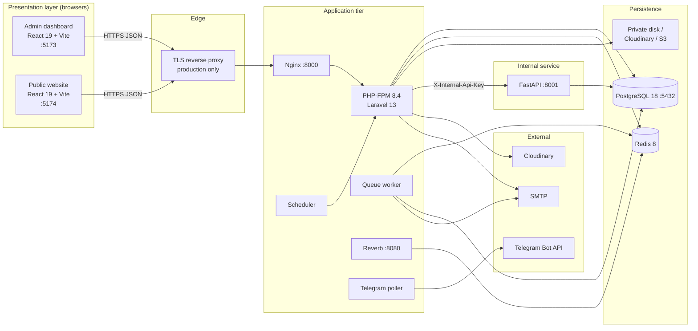
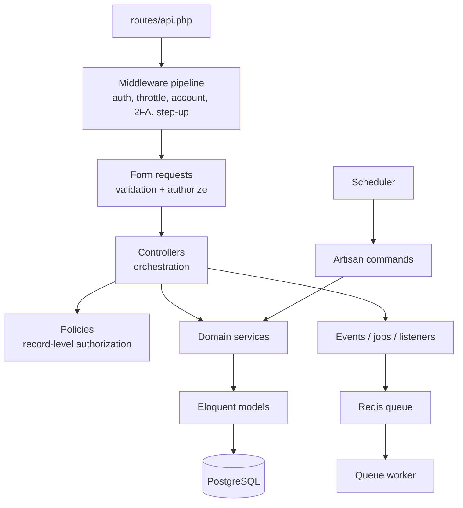
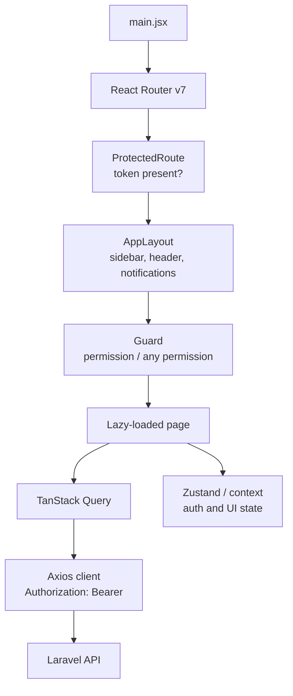
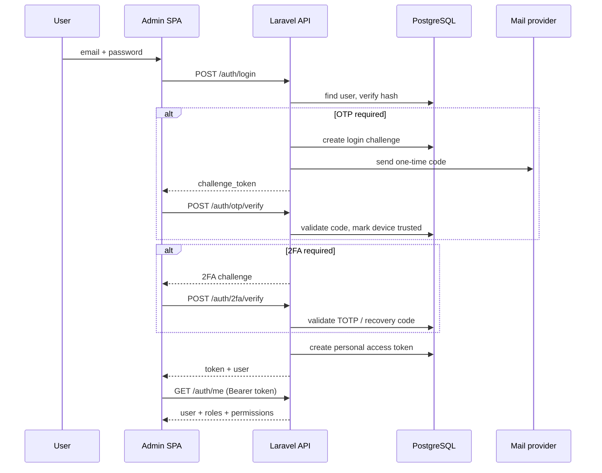
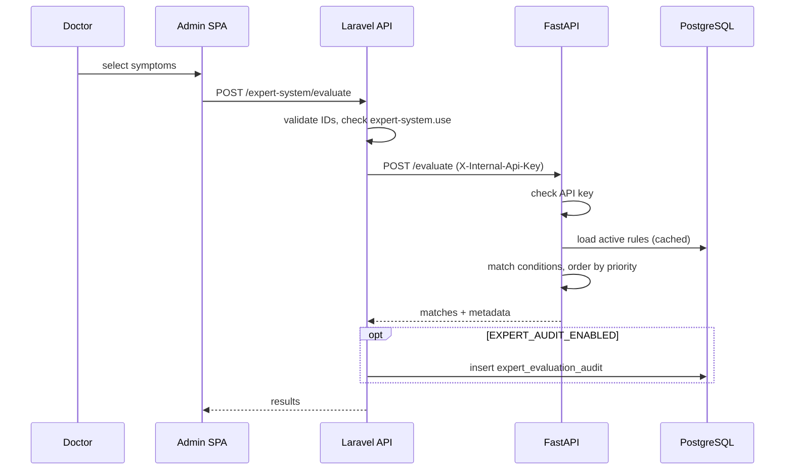

# 04 · System Design

## 4.1 Overall System Architecture



### Monorepo topology

| Component | Runtime | State |
| --- | --- | --- |
| `backend/` | PHP 8.4-FPM + Nginx + Supervisor | Stateless HTTP; all state in PostgreSQL/Redis/disk |
| `frontend/` | Vite dev server in Compose; static bundle in production | Browser state (token, query cache) |
| `website/` | Vite dev server in Compose; static bundle in production | Browser query cache only |
| `expert-system/` | Uvicorn | Stateless, with an in-process rule cache |
| `postgres` | PostgreSQL 18 | Durable system of record |
| `redis` | Redis 8 | Ephemeral cache, sessions, queues |
| `docker/nginx/` | Nginx edge proxy | Production TLS termination (example) |

## 4.2 Backend Architecture



### Architectural layers and responsibilities

| Layer | Responsibility | Examples |
| --- | --- | --- |
| Routes | URL, HTTP verb, middleware, rate limiter | `routes/api.php`, `routes/channels.php` |
| Middleware | Cross-cutting request checks | `EnsureAccountIsActive`, `EnsurePasswordIsCurrent`, `EnsureTrustedDevice`, `EnsureTwoFactorEnrolled`, `EnsureStepUp`, `SecurityHeaders` |
| Form requests | Input validation and request authorization | `app/Http/Requests/` |
| Controllers | HTTP orchestration and response shaping | `app/Http/Controllers/Api/` |
| Policies | Record-level authorization | `app/Policies/` |
| Services | Business rules and transactions | Auth, billing, inventory, inpatient, nursing, files, Telegram, website |
| Models | Persistence and relationships | `app/Models/` |
| Events / jobs / listeners | Asynchronous side effects | `app/Events/`, `app/Jobs/`, `app/Listeners/` |
| Commands | Scheduled and operational tasks | `telegram:poll`, `attendance:finalize`, `announcements:publish-scheduled`, `nursing:notify-overdue`, `alerts:generate` |

Design conventions:

- Controllers stay thin; multi-step business rules live in services.
- Financial and stock operations run inside database transactions and use
  `lockForUpdate()` where balances are mutated.
- Validation is centralized in form requests; controllers add domain validation.
- Responses use a `data` envelope. Validation failures use Laravel's `422`
  structure with an `errors` map.
- Sensitive actions are guarded by permissions **and** policies/middleware.

### Service groups

| Group | Services |
| --- | --- |
| Auth | `LoginChallengeService`, `TrustedDeviceService`, `TotpService`, `TwoFactorService`, `TwoFactorChallengeService`, `PasswordResetOtpService`, `AccountSecurityService`, `EmailChangeService`, `StepUpService`, `SecurityEventService`, `StaffProvisioningService` |
| Alerts | `SystemAlertGenerator`, `SystemAlertService` |
| Announcements | `AnnouncementService`, `AnnouncementPosterStorage` |
| Attendance | `AttendanceClockService`, `AttendanceFinalizationService`, `AttendanceSessionService`, `ShiftSchedulingService`, audits |
| Communication | `ConversationService`, attachment and serialization services |
| Dashboard | `DashboardMetricsService` |
| Files | Disk/Cloudinary storage, ClamAV or null scanner, patient and staff document services, video inspector |
| Inpatient | `InpatientBillingService`, `RoomChargeService` |
| Nursing | `AdmissionService`, `NursingTaskService`, `MedicationAdministrationService`, `PatientAccessService`, `VitalSignService`, assignment audit |
| Pharmacy | `InventoryService` |
| Staff | `StaffService` |
| Telegram | Client, link, conversation, reply, update handler, message templates |
| Website | Media service, media storage, media usage service |

## 4.3 Admin Frontend Architecture



| Concern | Implementation |
| --- | --- |
| Routing | `src/router/index.jsx`; lazy routes with a suspense fallback |
| Access guard | `ProtectedRoute` checks authentication; `Guard` checks one or more permissions |
| Auth state | `src/context/AuthProvider` plus the token storage helper |
| Server state | TanStack Query with per-feature query keys |
| HTTP | `src/api/client.js` and feature modules under `src/api/` |
| UI system | Tailwind v4 tokens in `src/styles/globals.css`, shadcn/Base UI primitives |
| Feedback | Sonner toasts, skeleton loaders, error states |
| Realtime | Laravel Echo/Reverb client configuration from `VITE_REVERB_*` |
| Localization | `src/i18n/` and Khmer-capable fonts; full UI translation is **Unverified** |

Frontend checks are usability controls only. The backend enforces authorization.

## 4.4 Public Website Architecture

| Concern | Implementation |
| --- | --- |
| Routing | `src/router/index.jsx` with `createBrowserRouter` |
| Data | TanStack Query + axios against public `/website/*` endpoints |
| State | No auth state and no persisted user data |
| Content | CMS-managed pages, services, team, gallery, articles, settings |
| Contact | `POST /website/contact`, throttled |
| Build | Vite static bundle in `website/dist/` |
| SEO | Per-page titles and metadata in components; deep links require SPA fallback |

The public site never calls an authenticated endpoint.

## 4.5 API Architecture and Standards

### Base URL and protocol

- Base path: `/api/v1`
- Local HTTP: `http://localhost:8000/api/v1`
- Production: HTTPS only
- Content type: `application/json`, except uploads (`multipart/form-data`) and
  PDF/CSV downloads

### Request and response standards

| Concern | Standard |
| --- | --- |
| Success body | `{ "data": ... }`; some actions add flags such as `duplicate` |
| Validation failure | HTTP `422` with `message` and `errors` |
| Authentication failure | HTTP `401` |
| Authorization failure | HTTP `403` |
| Missing resource | HTTP `404` |
| Rate limit / lockout | HTTP `429` |
| Server error | HTTP `500`; `503` when a dependency is unavailable; `504` on the expert-service timeout |
| Pagination | Laravel paginator shape (`data`, `meta`, `links`) where lists are paginated |
| Filtering | Query parameters per endpoint; see feedback filters such as status, date, or search |
| Idempotency | POS checkout uses a required UUID `idempotency_key` |

### Middleware stack

Protected routes are wrapped with:

```text
auth:sanctum, throttle:api, account.active, password.current
  + verified                 (when AUTH_REQUIRE_VERIFIED_EMAIL=true)
  + device.trust             (when AUTH_ENFORCE_TRUSTED_DEVICE=true)
  + 2fa.enrolled             (when AUTH_2FA_MANDATORY=true)
```

Additional per-route middleware includes `step.up:<permission>` for sensitive
actions and specialized throttles for login, OTP, password reset, invitations,
2FA, Telegram webhook, and attendance scanning.

### Rate limits

| Limiter | Limit | Key |
| --- | --- | --- |
| `api` | 60/min | User ID or IP |
| `login` | 5/min | Email + IP |
| `otp` | 5/min | Challenge + IP |
| `password-reset` | 5/min | Email + IP |
| `two-factor` | Configured per challenge | Challenge + IP |
| `invitation` | Configured throttle | Request key |
| `attendance-scan` | Configured throttle | Request key |
| `telegram-webhook` | Configured throttle | Request key |

## 4.6 Authentication Architecture



| Mechanism | Design |
| --- | --- |
| Token type | Sanctum personal access token, sent as `Authorization: Bearer <token>` |
| Token lifetime | `SANCTUM_EXPIRATION` minutes (default 480 in `.env.example`) |
| Trusted device | HttpOnly cookie, configurable lifetime (`AUTH_TRUSTED_DEVICE_DAYS`, default 30) |
| OTP | 6 digits, 10-minute expiry, 5 attempts, 60-second resend cooldown (defaults) |
| TOTP | 6 digits, 30-second period, ±1 window, 8 recovery codes (defaults) |
| Password reset | Emailed 6-digit code replaces the reset link; short-lived reset token |
| Email change | Two-stage code sent to the new address |
| Step-up | Short-lived, single-use grant consumed through `X-Step-Up-Token` |
| Lockout | Optional progressive lockout after 10 failed attempts in 15 minutes by default |
| Email verification | Optional enforcement; seeded accounts are marked verified |

## 4.7 Authorization Architecture

- Spatie roles: `Admin`, `Receptionist`, `Nurse`, `Head Nurse`, `Doctor`,
  `Pharmacist`, `Patient`.
- Permissions are seeded in `RolePermissionSeeder` and checked by middleware,
  form requests, and policies.
- Admin receives every permission at seed time. New permissions require a seeder
  update and a re-run in each environment.
- Some resources add policy rules beyond permissions, such as record ownership
  for patients, the last-admin rule, and step-up requirements.
- Inpatient billing and nursing use dedicated permissions so that legacy
  `billing.*` access cannot expose inpatient financial or nursing data.
- UI guards mirror permissions for navigation, but they are not a security
  boundary.

## 4.8 End-to-End Sequence Diagrams

### 4.8.1 POS checkout

```mermaid
sequenceDiagram
    participant P as Pharmacist
    participant SPA as Admin SPA
    participant API as Laravel API
    participant INV as InventoryService
    participant DB as PostgreSQL

    P->>SPA: select medicines and quantities
    SPA->>API: POST /pharmacy/pos/checkout
    API->>DB: lookup idempotency_key
    alt key exists
        API-->>SPA: 200 existing sale, duplicate true
    else new sale
        API->>DB: BEGIN; lock medicine rows
        API->>API: validate stock flags and compute totals
        API->>DB: insert sale, invoice, invoice items, sale items
        API->>INV: allocateForItems(...)
        INV->>DB: lock batches, insert allocations + stock movements
        alt payment supplied
            API->>DB: insert payment, mark invoice paid
        end
        API->>DB: COMMIT
        API-->>SPA: 201 sale + allocations
    end
```

### 4.8.2 Expert-system evaluation



### 4.8.3 Document upload and download

```mermaid
sequenceDiagram
    participant U as Staff
    participant SPA as Admin SPA
    participant API as Laravel API
    participant FS as Disk/Cloudinary
    participant DB as PostgreSQL

    U->>SPA: choose file
    SPA->>API: POST /patients/{id}/documents (multipart)
    API->>API: validate size/type; optional virus scan
    API->>FS: store private object
    API->>DB: insert patient_documents row
    API-->>SPA: document metadata
    U->>SPA: download
    SPA->>API: GET /documents/{id}/download (Bearer token)
    API->>API: authorize documents.view + policy
    API->>FS: stream object
    API-->>SPA: file stream
```

## 4.9 Security Architecture

| Control | Design |
| --- | --- |
| Transport | TLS terminated at a reverse proxy in production; HTTPS-only URLs |
| Passwords | Hashed with bcrypt; minimum length configurable (default 8) |
| Tokens | Sanctum bearer tokens; per-session revocation; expiration configurable |
| Cookies | Trusted-device cookie is HttpOnly; production requires secure cookies |
| CORS | Explicit allowed origins from `CORS_ALLOWED_ORIGINS`; credentials allowed for the device cookie |
| Rate limiting | Dedicated limiters for login, OTP, reset, invitation, 2FA, attendance, Telegram |
| Account states | `pending`, `pending_approval`, `active`, `suspended`, `disabled`, `rejected` |
| Step-up | Sensitive actions require a fresh identity proof and a single-use grant |
| Last admin | The final active administrator cannot be suspended or disabled |
| Files | Private storage; authorized or signed downloads; optional ClamAV scanning |
| Public surface | Only `/website/*`, contact intake, poster images, email verification, and Telegram webhook are unauthenticated |
| Headers | `SecurityHeaders` middleware; the example proxy adds HSTS, nosniff, frame denial, referrer policy |
| Audit | Activity logs, security events, assignment audits, attendance audits, expert evaluation audits |
| Secrets | Environment variables only; `.env` files must never be committed or baked into images |

Known security caveats:

- `backend/.dockerignore` does not exclude `.env`, so a production image build can
  include a local environment file. Review before building.
- The example reverse proxy sets `client_max_body_size 8m`, below the backend's
  `64m`; raise it before enabling large uploads.
- Demo accounts exist in local/testing seeds. Remove or disable them in
  production.
- Email verification, OTP login, 2FA enforcement, and lockout are **off by
  default**.
