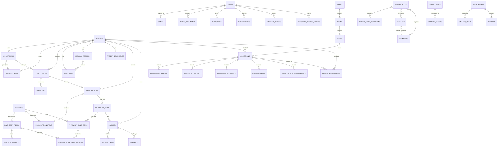

# 05 · Database Design

## 5.1 Database Architecture

- **Engine:** PostgreSQL 18 (`postgres:18`), database `clinic_db` by default.
- **Connection:** Laravel uses `pdo_pgsql`; the Compose host is `postgres:5432`.
- **Cache/session/queue:** Redis 8, not part of the durable schema.
- **Migrations:** `backend/database/migrations/` is the source of truth.
- **Tests:** forced to in-memory SQLite (`DB_CONNECTION=sqlite`,
  `DB_DATABASE=:memory:`) by `backend/phpunit.xml`.
- **Naming:** plural snake_case tables; `created_at`/`updated_at` timestamps;
  soft deletes on selected clinical tables.
- **Character support:** UTF-8, with Khmer content stored in website, knowledge
  base, and bilingual demo records.

### Architectural highlights

- Foreign keys use `restrictOnDelete`, `cascadeOnDelete`, or `nullOnDelete` to
  preserve financial and clinical history.
- Stock and financial writes are transactional and use row locks.
- The POS tables enforce unique `sale_number` and unique `idempotency_key`.
- Audit tables record who changed what, including assignment, attendance, and
  expert-evaluation history.
- Dashboard analytics are served by read-only SQL views so both PostgreSQL and
  the SQLite test suite can execute them.

## 5.2 Entity Relationship Diagram (ERD)



## 5.3 Table Inventory

### 5.3.1 Identity, access, and security

| Table | Purpose | Notable constraints |
| --- | --- | --- |
| `users` | Staff, patient-role, and admin accounts | Unique email/username; status lifecycle; soft deletes |
| `sessions` | Session store when the session driver is database | Indexed by user |
| `personal_access_tokens` | Sanctum bearer tokens | Token hash unique; abilities and expiry |
| `password_reset_tokens` | Laravel password broker table | Email primary key |
| `password_reset_otps` | Emailed password-reset codes | Hashed code, expiry, attempt count, reset token |
| `login_challenges` | OTP login challenges | Challenge token, expiry, attempts |
| `trusted_devices` | Remembered devices | Cookie token hash, expiry |
| `two_factor_challenges` | Pending TOTP challenges | Challenge token, expiry, attempts |
| `two_factor_recovery_codes` | Recovery codes | Hashed, single use |
| `step_up_authorizations` | Short-lived sensitive-action grants | Bound to user and action, expiry |
| `email_change_requests` | Two-stage email change | New email, code, expiry |
| `security_events` | Login, lockout, and account events | Actor, type, severity, IP/user agent |
| `activity_logs` | General user activity audit | Subject, causer, properties |
| `staff_invitations` | Pending staff invitations | Hashed token, email, expiry, status |
| `permissions`, `roles`, `model_has_permissions`, `model_has_roles`, `role_has_permissions` | Spatie RBAC | Created by the package migrations |

### 5.3.2 Patients and clinical care

| Table | Purpose |
| --- | --- |
| `patients` | Master patient demographic record |
| `patient_documents` | Private uploaded documents with storage metadata |
| `appointments` | Scheduled visits, clinician, date/time, status |
| `queue_entries` | Outpatient waiting list linked to appointments |
| `vital_signs` | Recorded measurements per patient/visit |
| `consultations` | Clinical encounter notes |
| `diagnoses` | Diagnoses linked to a consultation/patient |
| `medical_records` | Consolidated clinical record entries |

### 5.3.3 Pharmacy and inventory

| Table | Purpose | Notable constraints |
| --- | --- | --- |
| `medicines` | Catalog with pricing, reorder level, `requires_prescription`, recall/active flags | Unique medicine identity as defined in migrations |
| `inventory_items` | Batches with quantity, expiry, and location | Belongs to a medicine |
| `stock_movements` | In/out/adjustment history | References inventory item, actor, and reason |
| `prescriptions` | Prescription header and status | Belongs to patient and prescriber |
| `prescription_items` | Medicine, dose, quantity, instructions | Belongs to prescription and medicine |
| `pharmacy_sales` | POS sale header | `sale_number` unique; `idempotency_key` unique; index on `status, created_at` |
| `pharmacy_sale_items` | Sold medicine lines | Cascade with sale; medicine restricted |
| `pharmacy_sale_allocations` | Batch-level stock consumed per sale item | Sale item cascade; inventory item restricted |

`pharmacy_sales` columns: `id`, `sale_number`, `idempotency_key`, nullable
`patient_id`, `prescription_id`, `invoice_id`, `sold_by`, `status`, `subtotal`,
`discount`, `total`, `void_reason`, `voided_by`, `voided_at`, timestamps.

### 5.3.4 Billing and inpatient finance

| Table | Purpose |
| --- | --- |
| `invoices` | Invoice header with totals and status |
| `invoice_items` | Service, medicine, or manual lines |
| `payments` | Recorded payments with method and settlement time |
| `billable_services` | Catalog of chargeable services |
| `inpatient_billing_settings` | Room/charge configuration for admissions |
| `admission_billing_runs` | Daily billing generation runs |
| `admission_charges` | Room and ad-hoc charges |
| `admission_deposits` | Deposits held against an admission |
| `admission_transfers` | Bed/ward transfer history |

### 5.3.5 Inpatient operations

| Table | Purpose |
| --- | --- |
| `wards` | Wards/departments |
| `rooms` | Rooms within a ward |
| `beds` | Beds within a room, with status |
| `admissions` | Inpatient stay header |
| `patient_assignments` | Nurse-to-patient assignments |
| `nursing_tasks` | Scheduled nursing work with due time and completion |
| `medication_administrations` | MAR entries and administration status |
| `assignment_audit_logs` | Assignment change audit |

### 5.3.6 Staff, attendance, scheduling, and leave

| Table | Purpose |
| --- | --- |
| `staff` | Staff directory, department, job title, salary, linked user |
| `staff_documents` | Private staff documents |
| `staff_salary_histories` | Salary change history |
| `leave_requests` | Leave requests and approvals |
| `attendance_records` | Clock-in/out and daily attendance |
| `attendance_sessions` | Rotating QR attendance sessions |
| `attendance_session_tokens` | Rotating session tokens |
| `attendance_corrections` | Manual corrections |
| `attendance_audit_logs` | Attendance audit trail |
| `shift_templates` | Reusable shift definitions |
| `shifts` | Published/planned rosters |
| `clinic_holidays` | Holiday calendar |

### 5.3.7 Communication and alerts

| Table | Purpose |
| --- | --- |
| `conversations` | Direct and group conversations |
| `conversation_participants` | Membership and roles |
| `conversation_messages` | Messages and attachment metadata |
| `conversation_message_reads` | Per-user read state |
| `conversation_message_user_deletes` | Per-user message deletion |
| `announcements` | Announcement content and lifecycle |
| `announcement_reads` | Read receipts |
| `notifications` | Laravel in-app notifications |
| `notification_preferences` | Per-user channel preferences |
| `system_alerts` | Generated infrastructure/operational alerts |
| `telegram_connections` | Linked Telegram accounts |
| `telegram_linking_tokens` | One-time linking tokens |
| `telegram_group_configs` | Group notification configuration |
| `telegram_delivery_logs` | Delivery attempts and results |

### 5.3.8 Website CMS and public content

| Table | Purpose |
| --- | --- |
| `website_settings` | Site-wide settings and hero/contact content |
| `public_pages` | CMS pages with slug and publish state |
| `content_blocks` | Editable blocks on pages/sections |
| `services` | Public service catalog |
| `public_team_profiles` | Public team members |
| `gallery_items` | Public gallery entries |
| `articles` | Health news and articles |
| `media_assets` | Uploaded media metadata |
| `contact_messages` | Public contact-form submissions |

### 5.3.9 Expert system

| Table | Purpose |
| --- | --- |
| `diseases` | Disease catalog (bilingual fields) |
| `symptoms` | Symptom dictionary |
| `disease_symptom` | Disease-to-symptom mapping |
| `expert_rules` | Rules with priority, confidence, and active flag |
| `expert_rule_conditions` | AND/OR conditions, operator, expected value |
| `expert_evaluation_audits` | Optional evaluation audit rows |

### 5.3.10 Infrastructure

| Table | Purpose |
| --- | --- |
| `cache`, `cache_locks` | Database cache fallback |
| `jobs`, `job_batches`, `failed_jobs` | Queue and failure tracking |
| `sessions` | Database session fallback |
| `migrations` | Applied migration ledger |

## 5.4 Database Views

Created by `2026_11_05_000001_create_dashboard_analytics_views.php`:

| View | Purpose |
| --- | --- |
| `vw_appointments_daily` | Non-deleted appointments grouped by day and status |
| `vw_patients_daily` | Non-deleted patients grouped by registration day |
| `vw_revenue_daily` | Recorded payments grouped by settlement day |
| `vw_medicine_stock` | On-hand stock per medicine with reorder threshold |
| `vw_inventory_expiring` | Inventory batches approaching expiry |

The SQL uses ANSI aggregates, `date()`, and `substr()` so it runs on both
PostgreSQL and SQLite. `DashboardMetricsService` reads these views.

## 5.5 Indexes, Constraints, and Known Gaps

- POS: unique `pharmacy_sales.sale_number`, unique
  `pharmacy_sales.idempotency_key`, index `(status, created_at)`.
- Foreign keys on sale items and allocations protect stock history.
- Expert rule conditions are read by `expert_rule_id`; dedicated indexes on
  `expert_rule_conditions(expert_rule_id)` are **not** added. Acceptable for the
  current small knowledge base, worth revisiting at scale.
- Soft-deleted clinical rows are explicitly excluded from dashboard views.
- Column-level details for every table are defined in
  `backend/database/migrations/`; this guide intentionally avoids duplicating
  every column so it cannot drift from the migrations.

## 5.6 Seeders

`DatabaseSeeder` always runs:

| Seeder | Purpose |
| --- | --- |
| `RolePermissionSeeder` | Creates roles, permissions, and role assignments |
| `AdminUserSeeder` | Creates the local administrator account |
| `ShiftTemplateSeeder` | Baseline shift templates |
| `WebsiteContentSeeder` | Baseline website settings and the About page |
| `LegalDocumentSeeder` | Privacy Policy and Terms of Use with structured EN/KM content |
| `AboutContentBlockSeeder` | About-page content blocks |
| `WebsitePageContentSeeder` | Baseline CMS pages |

In `local` and `testing` only, it also runs:

| Seeder | Purpose |
| --- | --- |
| `DemoUsersSeeder` | Demo staff and patient accounts |
| `KhmerDemoDataSeeder` | Khmer bilingual demo records |
| `QueueDemoSeeder` | Demo outpatient queue |
| `WardRoomBedDemoSeeder` | Demo wards, rooms, and beds |
| `InpatientDemoDataSeeder` | Demo admissions and inpatient data |
| `WebsiteDemoContentSeeder` | Demo website media and content |

The knowledge-base seeders (`KnowledgeBaseSeeder`,
`KnowledgeBase100CatalogSeeder`, `ExpertRuleKhmerSeeder`) are available but not
part of `DatabaseSeeder`; run them explicitly if you need the starter catalog.

> **Do not run `db:seed` against production data.** The seeders create demo
> accounts and reference content. Demo passwords are intentionally not reproduced
> in this documentation; read them from `DemoUsersSeeder` in a local checkout.

## 5.7 Backup, Migration, and Recovery Notes

- Apply migrations deliberately: `php artisan migrate --force` after a verified
  backup.
- Never run `migrate:fresh`, `db:wipe`, `migrate:rollback`, or
  `docker compose down -v` against clinic data.
- Back up with `pg_dump --format=custom`, store encrypted off-host, and test
  restores in a separate environment.
- Back up uploaded documents if a local disk is used.
- Record the release commit with each backup.
- Migrations are not run automatically by the backend container.

### 5.7.1 Read-only verification queries

```powershell
docker compose exec -T postgres psql -U clinic_user -d clinic_db -c "SELECT COUNT(*) AS users FROM users;"
docker compose exec -T postgres psql -U clinic_user -d clinic_db -c "SELECT COUNT(*) AS migrations FROM migrations;"
```

If your local user or database name differs, use the values from the root
`.env`.

### 5.7.2 Common database errors

| Error | Likely cause | Safe fix |
| --- | --- | --- |
| `password authentication failed` | Wrong credentials | Check root `.env`, then recreate the affected containers |
| `database "clinic_db" does not exist` | Fresh volume or wrong name | Check `POSTGRES_DB` |
| `relation "..." does not exist` | Migrations not applied | Run `migrate:status`, then apply migrations safely |
| `SQLSTATE[42P01]` in logs | Missing table or stale code/schema | Check migration status and deployment order |
| `could not connect to server` | PostgreSQL not running or unhealthy | `docker compose ps` and `docker compose logs postgres` |
| Disk full during migration or backup | Insufficient storage | Free space or add capacity; do not retry a partial migration blindly |
| `title_km does not exist` in old logs | Historical error before the Khmer migration | Confirm the migration is applied; old lines are not current failures |
