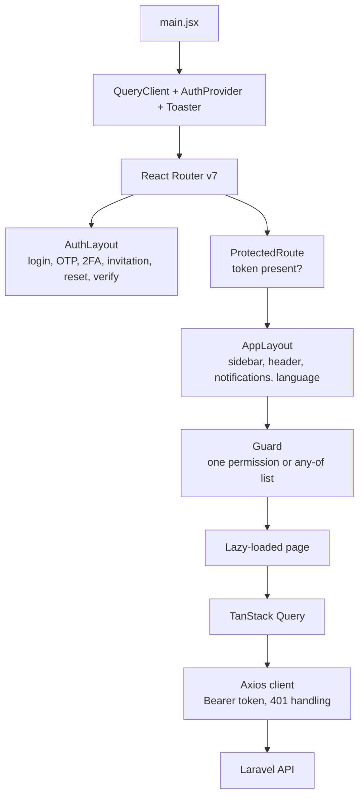

# 08 · Frontend Documentation

The project has two independent React single-page applications:

| Application | Folder | Default URL | Audience |
| --- | --- | --- | --- |
| **Admin dashboard** | `frontend/` | `http://localhost:5173` | Clinic staff and administrators |
| **Public website** | `website/` | `http://localhost:5174` | Public visitors (read-only) |

Both are React 19 + Vite applications written in JavaScript/JSX. They share the
same Laravel API (`/api/v1`) but have no shared runtime code, no shared build,
and no cross-links from the public site to the admin app.

## 8.1 Admin Dashboard

### 8.1.1 Stack

| Concern | Implementation |
| --- | --- |
| UI | React 19, JavaScript/JSX |
| Build and dev server | Vite |
| Routing | React Router v7 (`createBrowserRouter`) |
| Server state | TanStack Query |
| Client state | Zustand, React context |
| HTTP | Axios (`src/api/client.js`) |
| Styling | Tailwind CSS v4, tokens in `src/styles/globals.css` |
| Components | shadcn / Base UI primitives, `class-variance-authority`, `tailwind-merge`, `clsx` |
| Icons and motion | Lucide, React Icons, Framer Motion, Swiper |
| Forms and validation | Zod |
| Feedback | Sonner toasts, skeleton loaders |
| Dates and files | `date-fns`, `react-day-picker`, `react-easy-crop`, `html2canvas-pro`, `jspdf`, `qrcode.react`, `html5-qrcode` |
| Realtime | Laravel Echo + Pusher JS against Reverb |
| Fonts | Geist and Kantumruy Pro variable fonts (Khmer support) |
| Lint | Oxlint |
| i18n | `src/i18n/` — Khmer-capable; full UI translation coverage is **Unverified** |

`npm run build` runs `vite build` only. It does **not** type-check; this is a
JavaScript/JSX codebase.

### 8.1.2 Application shell



| Component | Responsibility |
| --- | --- |
| `src/router/ProtectedRoute.jsx` | Redirects unauthenticated users to `/login` |
| `src/router/Guard.jsx` | Renders a screen only when the user holds the required permission(s); otherwise shows `/forbidden` |
| `src/components/layout/AppLayout.jsx` | Persistent sidebar, header, notification bell, account menu |
| `src/context/AuthProvider.jsx` | Loads `/auth/me`, stores the authenticated user, roles, and permissions |
| `src/api/client.js` | Base URL, bearer header, auth-event dispatch on `401` |
| `src/constants/navigation.js` | Permission-aware navigation entries and coming-soon placeholders |

Frontend guards are usability controls only. Every protected operation is
re-authorized by the backend.

### 8.1.3 Route map

Authentication routes render inside `AuthLayout`; all other routes render inside
`ProtectedRoute → AppLayout → Guard`.

#### Authentication and account recovery (public)

| Path | Screen | API |
| --- | --- | --- |
| `/login` | Password sign-in | `POST /auth/login` |
| `/login/verify` | Email OTP challenge | `POST /auth/otp/verify`, `POST /auth/otp/resend` |
| `/login/2fa` | TOTP / recovery-code challenge | `POST /auth/2fa/verify` |
| `/accept-invitation` | Accept a staff invitation and set a password | `/auth/invitation/lookup`, `/auth/invitation/accept` |
| `/forgot-password` | Request a reset code | `POST /auth/forgot-password` |
| `/reset-password` | Verify the reset code | `POST /auth/reset-password/verify-code` |
| `/reset-password/new` | Set the new password | `POST /auth/reset-password` |
| `/verify-email` | Email verification landing page | Signed verification link |

#### Operational screens (authenticated)

| Path | Screen | Permission guard |
| --- | --- | --- |
| `/` | Dashboard analytics | Authenticated |
| `/patients` | Patient list | `patients.view` |
| `/patients/:id` | Patient detail, documents, clinical tabs | `patients.view` |
| `/appointments` | Appointment list | `appointments.view` |
| `/appointments/:id` | Appointment detail | `appointments.view` |
| `/queue` | Outpatient queue | `queue.view` |
| `/medical-records` | Medical records | `medical-records.view` |
| `/prescriptions` | Prescription list | `prescriptions.view` |
| `/prescriptions/:id` | Prescription detail and dispense | `prescriptions.view` |
| `/wards` | Wards, rooms, beds | `wards.view` or `beds.view` |
| `/admissions` | Inpatient admissions | `admissions.view` |
| `/admissions/:id/billing` | Inpatient billing workspace | `admissions.view` |
| `/nursing-tasks` | Nursing task board | `nursing-tasks.view` |
| `/mar` | Medication administration records | `medications.view` |
| `/assignments` | Nurse–patient assignments | `assignments.view` |
| `/pharmacy` | Medicines and inventory tabs | `medicines.view` |
| `/pharmacy/dashboard` | Pharmacy stock dashboard | `medicines.view` or `inventory.view` |
| `/pharmacy/pos` | Point-of-sale checkout | `medicines.view` or `inventory.view` |
| `/inventory` | Inventory-only view | `inventory.view` |
| `/billing` | Invoice list | `billing.view` |
| `/billing/:id` | Invoice detail, payments, PDF | `billing.view` |
| `/reports` | Reports and exports | `reports.view` |
| `/expert-system` | Rule evaluation and audit | `expert-system.view` or `expert-system.use` |
| `/notifications` | In-app notifications | Authenticated |
| `/news` | Announcement/news feed | `announcements.view` |
| `/announcements` | Announcement management | `announcements.create/update/publish` |
| `/chat`, `/chat/:id` | Direct and group chat | `chat.view` |
| `/leave` | Leave requests | `leave.view` |
| `/attendance` | Attendance records | `attendance.view` |
| `/attendance/scan` | QR attendance scanner | `attendance.clock` |
| `/scheduling` | Shift board and templates | `scheduling.view` |
| `/settings` | Account, security, 2FA, devices, preferences | Authenticated |
| `/forbidden` | Permission-denied page | Authenticated |

#### Administration and CMS

| Path | Screen | Permission guard |
| --- | --- | --- |
| `/users` | User accounts and roles | `users.view` |
| `/staff` | Staff directory | `staff.view` |
| `/staff/:id` | Staff detail, salary, documents | `staff.view` |
| `/invitations` | Staff invitations | `users.invite` |
| `/approvals` | Pending account approvals | `users.approve` |
| `/audit-logs` | Activity log | `audit-logs.view` |
| `/website` | CMS dashboard | `website.view` |
| `/website/settings` | Site settings | `website.settings.view` |
| `/website/content-blocks` | Editable content blocks | `website.settings.view` |
| `/website/pages`, `/website/pages/:id` | CMS pages | `website.pages.view` |
| `/website/services`, `/website/services/:id` | Services | `website.view` |
| `/website/team`, `/website/team/:id` | Team profiles | `website.view` |
| `/website/gallery`, `/website/gallery/:id` | Gallery | `website.view` |
| `/website/articles`, `/website/articles/:id` | Articles | `website.articles.view` |
| `/website/media` | Media library | `website.media.manage` |
| `/website/contact-messages` | Contact inbox | `website.view` |
| `/website/preview` | CMS preview | `website.view` |

#### Standalone and fallback routes

| Path | Screen | Notes |
| --- | --- | --- |
| `/attendance/kiosk/:sessionId` | Full-screen QR kiosk | `ProtectedRoute` + `attendance.session`; renders outside `AppLayout` |
| `/coming-soon/*` | Placeholder screens | Generated from `COMING_SOON_ITEMS` in `src/constants/navigation.js` |
| `*` | Not-found page | Public fallback |

The authoritative list is `frontend/src/router/index.jsx`.

### 8.1.4 API modules

`frontend/src/api/` contains one module per backend domain:

```text
src/api/
├── client.js              # Axios instance and interceptors
├── auth.js  userSettings.js
├── patients.js  documents.js  appointments.js  queue.js  clinical.js
├── prescriptions.js  pharmacy.js
├── billing.js  inpatientBilling.js  reports.js  dashboard.js
├── users.js  staff.js  staffInvitations.js  staffApprovals.js
├── attendance.js  shifts.js  shiftTemplates.js  leave.js  scheduling
├── announcements.js  news.js  communication.js
├── expert.js  audit.js  search.js
└── website.js  websiteAdmin.js
```

Every module wraps the shared client, so authentication, base URL, and `401`
handling are applied consistently.

### 8.1.5 State management

| State type | Tool | Examples |
| --- | --- | --- |
| Authenticated user, roles, permissions | React context (`AuthProvider`) | Guard checks, navigation visibility |
| Server data and caching | TanStack Query | Patient lists, dashboard metrics, queues |
| UI/ephemeral state | Zustand and component state | POS cart, filters, drawers |
| Form state and validation | Local state + Zod | Patient, appointment, and invoice forms |
| Realtime messages | Laravel Echo / Reverb | Chat and broadcast updates |

Rules of thumb used in the codebase:

- Server state belongs in TanStack Query, with per-feature query keys and
  invalidation after mutations.
- Do not mirror permissions in multiple stores; read them from the auth context.
- The POS cart is client-side only. Prices and totals are **always** recalculated
  by the backend.

### 8.1.6 Design system

- Tailwind v4 tokens and base styles live in `src/styles/globals.css`.
- Reusable primitives live in `src/components/ui/` (buttons, dialogs, tables,
  inputs, skeletons, toasts).
- Domain components are grouped by feature under `src/components/<domain>/`.
- Layout, sidebar, and header components live in `src/components/layout/`.
- Status colours and labels are centralized in `src/utils/` so lists and detail
  screens stay consistent.
- Loading states use skeleton components; empty and error states are explicit on
  each page.
- Khmer support relies on Kantumruy Pro. Language strings are in `src/i18n/`;
  complete translation coverage is **Unverified**.

### 8.1.7 Environment variables

Copy `frontend/.env.example` to `frontend/.env`.

| Variable | Default | Purpose |
| --- | --- | --- |
| `VITE_API_URL` | `http://localhost:8000/api/v1` | Laravel API base URL, no trailing slash |
| `VITE_PUBLIC_SITE_URL` | `http://localhost:5174` | Public website URL used by "View website" |
| `VITE_REVERB_APP_KEY` | empty | Must match backend `REVERB_APP_KEY` |
| `VITE_REVERB_HOST` | `localhost` | Public Reverb host |
| `VITE_REVERB_PORT` | `8080` | Public Reverb port |
| `VITE_REVERB_SCHEME` | `http` | Use `https` behind TLS |

Vite inlines `VITE_*` values at build time, so rebuild after changing them.
**Never** place secrets in `VITE_*` variables; they are shipped to the browser.

### 8.1.8 Commands and verified state

```powershell
cd frontend
npm install
npm run dev        # Vite dev server on 5173
npm run build      # production bundle in dist/
npm run preview    # preview the production build
npm run lint       # Oxlint; warnings do not fail the command
```

Last recorded in this working copy on 2026-10-29:

- `npm run lint` exits `0` with React Compiler warnings.
- `npm run build` succeeds.

### 8.1.9 Known frontend caveats

- The Docker image runs `npm run dev -- --host 0.0.0.0`. It is a development
  server and must not be used as a production web server.
- `npm audit` reports 7 high-severity advisories from the `shadcn` CLI
  development toolchain. There is no non-breaking fix recorded at the time of
  writing, and the toolchain is not shipped in the production bundle.
- Several lint warnings are React Compiler advisories (`set-state-in-effect`,
  `only-export-components`, missing effect dependencies), not build failures.
- Navigation entries exist for modules that are placeholders; those routes render
  `ComingSoonPage`.

## 8.2 Public Website

### 8.2.1 Stack

| Concern | Implementation |
| --- | --- |
| UI | React 19, JavaScript/JSX |
| Build | Vite |
| Routing | React Router v7 (`createBrowserRouter`) |
| Server state | TanStack Query |
| HTTP | Axios |
| Styling | Tailwind CSS v4, tokens in `src/styles/globals.css` |
| Content sanitization | DOMPurify |
| Icons and utilities | Lucide, `clsx`, `tailwind-merge`, `class-variance-authority` |
| Fonts | Geist and Kantumruy Pro variable fonts (Khmer support) |
| Lint | Oxlint |

The website contains **no** authentication, no patient data, and no private clinic
features. It only calls public, unauthenticated, read-only endpoints plus the
throttled contact form.

### 8.2.2 Route map

| Path | Page |
| --- | --- |
| `/` and `/home` | Home |
| `/about` | About Us (CMS `about` content) |
| `/services` | Services |
| `/team` | Our Team |
| `/gallery` | Facilities and gallery |
| `/health-news` and `/news` | News and health index |
| `/health-news/:slug` and `/news/:slug` | Article detail |
| `/contact` | Contact form |
| `/privacy-policy` and `/pages/privacy-policy` | Privacy policy |
| `/terms-of-use`, `/terms`, `/pages/terms-of-use` | Terms of use |
| `/pages/about` | Redirect to `/about` |
| `/pages/:slug` | Any other published CMS page |
| `*` | Not-found page |

### 8.2.3 API integration

| Endpoint | Use |
| --- | --- |
| `GET /website/bootstrap` | Site settings, footer pages, services |
| `GET /website/home` | Homepage sections |
| `GET /website/pages`, `/website/pages/{slug}` | CMS pages |
| `GET /website/services` | Services |
| `GET /website/team` | Team profiles |
| `GET /website/gallery` | Gallery |
| `GET /website/articles`, `/website/articles/{slug}` | News and health articles |
| `GET /website/media/{asset}` | Published media |
| `POST /website/contact` | Contact form submission (throttled) |

- Every request targets `VITE_API_URL` with no token.
- Published content only; unpublished records are not returned by the API.
- Per-page loading, empty, and error states are handled explicitly.
- Rich text returned by the CMS is sanitized with DOMPurify before rendering.

### 8.2.4 Environment and commands

Copy `website/.env.example` to `website/.env`.

| Variable | Purpose | Default |
| --- | --- | --- |
| `VITE_API_URL` | Laravel API base URL, no trailing slash | `http://localhost:8000/api/v1` |

```powershell
cd website
npm install
npm run dev        # Vite dev server on 5174
npm run build      # production bundle in dist/
npm run preview
npm run lint       # Oxlint
```

Last recorded in this working copy on 2026-10-29: lint exits `0` with warnings,
and the production build succeeds.

### 8.2.5 Content that is not verified

Some homepage content reproduces the design reference and is **not** confirmed
clinic data. Confirm or replace it before publishing:

| Item | Location | Status |
| --- | --- | --- |
| Hero highlights ("10,000+ Happy Patients", "50+ Specialists", "24 Hours") | `src/constants/index.js` (`HERO_STATS`) | Reference figures, **Unverified** |
| Partner strip (PharmaHealth, MediCare, LifePlus, HealthFirst, WellnessCo) | `PARTNER_PLACEHOLDERS` | Design-reference names, not confirmed partnerships |
| `about-clinic.jpg` | `public/media/` | Pexels stock photo (photo 4989168), Pexels License |
| `hero-background.png`, `royalcare-logo.png` | `public/` | Project assets |

Hero copy and the hero image are editable in the CMS. The stat cards and partner
strip remain code-level placeholders until CMS fields exist.

## 8.3 Build and Deployment Notes for Both SPAs

- Build with `npm run build`; serve `dist/` from a static host or a production
  web server.
- Configure an SPA fallback so deep links survive a refresh:

  ```nginx
  location / {
    try_files $uri $uri/ /index.html;
  }
  ```

- Set `VITE_API_URL` at build time to the deployed API URL, and add the deployed
  origin to the backend `CORS_ALLOWED_ORIGINS`.
- The admin app also needs `VITE_PUBLIC_SITE_URL` and the `VITE_REVERB_*` values.
- Both Dockerfiles start Vite in development mode. Do not deploy them as
  production servers.

See [10 · Deployment](../10-deployment/index.md) for the full topology.
