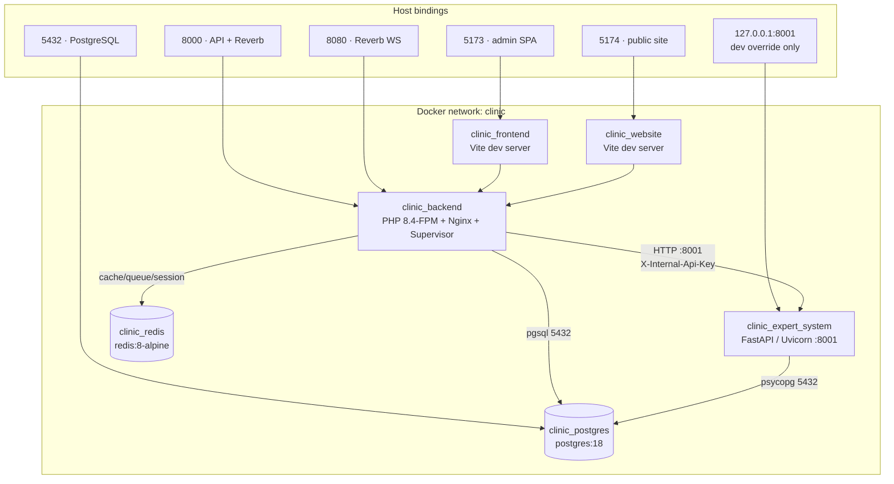

# 10 · Deployment & Infrastructure

> **Status:** No production deployment has been performed or verified in this
> working copy. Everything below is a configuration guide. **Unverified** means
> it cannot be confirmed from this repository.

## 10.1 Local Deployment Architecture

The stack is orchestrated by Docker Compose over an isolated bridge network named
`clinic`. Six services share that network; only four publish host ports.



### Development warnings

The base Compose file is a **development** stack:

- `backend` bind-mounts the source (`./backend:/var/www/html`) and hardcodes
  `APP_ENV: local`.
- `frontend` and `website` run `npm run dev`, not production builds.
- `postgres` publishes `5432` on the host.
- `docker-compose.override.yml` publishes the expert system on `127.0.0.1:8001`.

**Do not deploy this configuration to production.**

## 10.2 Service Topology

| Container | Base image | Internal ports | Host ports | Responsibility |
| --- | --- | --- | --- | --- |
| `clinic_backend` | `backend/Dockerfile` (php:8.4-fpm) | `8000`, `8080` | `${BACKEND_PORT}` (8000), `${REVERB_PORT}` (8080) | Nginx + PHP-FPM, plus Supervisor running the queue worker, scheduler, Reverb, and the Telegram poller |
| `clinic_frontend` | `frontend/Dockerfile` (Node 22) | `5173` | `${FRONTEND_PORT}` (5173) | Admin dashboard dev server |
| `clinic_website` | `website/Dockerfile` (Node 22) | `5174` | `${WEBSITE_PORT}` (5174) | Public website dev server |
| `clinic_expert_system` | `expert-system/Dockerfile` (python:3.12-slim) | `8001` | none in base; `127.0.0.1:8001` in the dev override | FastAPI rule engine |
| `clinic_postgres` | `postgres:18` | `5432` | `${POSTGRES_PORT}` (5432) | Durable system of record |
| `clinic_redis` | `redis:8-alpine` | `6379` | none | Cache, sessions, queues |

Volumes: `postgres_data` (database files) and `redis_data` (cache). Both survive
`docker compose down`; only `docker compose down -v` deletes them.

Health checks:

| Service | Check | Interval / retries |
| --- | --- | --- |
| `postgres` | `pg_isready -U $POSTGRES_USER -d $POSTGRES_DB` | 5 s / 10 |
| `redis` | `redis-cli ping` | 5 s / 10 |
| `expert-system` | `GET /health` from inside the container | 30 s / 3, 15 s start period |

`backend` waits for `postgres` and `redis` to be healthy and for
`expert-system` to have started.

### Backend container contents

`backend/Dockerfile` builds an image that:

- Installs `pdo_pgsql`, `pcntl`, and the phpredis extension.
- Copies Nginx, PHP, and Supervisor configuration from `backend/docker/`.
- Runs Nginx on `8000` inside the container.
- Starts PHP-FPM, Nginx, `queue:work`, `schedule:work`, Reverb, and
  `telegram:poll` under Supervisor.
- Runs an OPcache warmup step against `/up` after startup.

**Migrations are never run automatically.** They are a deliberate release step.

## 10.3 Configuration & Environment Variables

Three `.env` files exist and serve different layers:

| File | Consumer | Committed example |
| --- | --- | --- |
| `.env` (repo root) | Docker Compose variable substitution | `.env.example` |
| `backend/.env` | Laravel application | `backend/.env.example` |
| `frontend/.env`, `website/.env` | Vite build/dev server | `.env.example` in each app |

Never commit a real `.env`. Never paste a real secret into an issue, a chat, or a
document. Rotate anything that has been exposed.

### 10.3.1 Root Compose variables

| Variable | Default | Purpose |
| --- | --- | --- |
| `POSTGRES_DB` | `clinic_db` | Database name |
| `POSTGRES_USER` | `clinic_user` | Database user |
| `POSTGRES_PASSWORD` | `change_me` | **Replace before use** |
| `POSTGRES_PORT` | `5432` | Host port for PostgreSQL |
| `BACKEND_PORT` | `8000` | Host port for the API |
| `FRONTEND_PORT` | `5173` | Host port for the admin SPA |
| `WEBSITE_PORT` | `5174` | Host port for the public site |
| `REVERB_PORT` | `8080` | Host port for Reverb |
| `EXPERT_SYSTEM_URL` | `http://expert-system:8001` | Internal expert-system URL |
| `EXPERT_SYSTEM_TIMEOUT` | `15` | Laravel → expert-system timeout (seconds) |
| `EXPERT_SYSTEM_CONNECT_TIMEOUT` | `2` | Connect timeout (seconds) |
| `EXPERT_SYSTEM_API_KEY` | empty | Shared internal secret; set in production |
| `EXPERT_SYSTEM_LOG_LEVEL` | `INFO` | Uvicorn/app log level |
| `EXPERT_RULES_CACHE_TTL_SECONDS` | `60` | Rule cache TTL; `0` disables caching |
| `EXPERT_SYSTEM_REQUEST_TIMEOUT_SECONDS` | `15` | Per-request timeout inside FastAPI |
| `EXPERT_AUDIT_ENABLED` | `false` | Store evaluation audits (privacy-sensitive) |

### 10.3.2 Backend application variables

Grouped by concern. Defaults are from `backend/.env.example`; production values
are recommendations.

| Group | Variable | Default | Production note |
| --- | --- | --- | --- |
| App | `APP_ENV` | `local` | `production` |
| App | `APP_DEBUG` | `true` | `false` |
| App | `APP_KEY` | empty | `php artisan key:generate --show`, unique per environment |
| App | `APP_URL` | `http://localhost:8000` | Public HTTPS API URL |
| App | `APP_LOCALE` / `APP_FALLBACK_LOCALE` | `en` | Keep `en` unless translations are complete |
| Database | `DB_CONNECTION` | `pgsql` | `pgsql` |
| Database | `DB_HOST` | `127.0.0.1` | `postgres` in Compose |
| Database | `DB_DATABASE` / `DB_USERNAME` / `DB_PASSWORD` | local placeholders | Real credentials from a secret store |
| Cache | `CACHE_STORE` | `database` | `redis` |
| Queue | `QUEUE_CONNECTION` | `database` | `redis` |
| Session | `SESSION_DRIVER` | `database` | `redis` |
| Session | `SESSION_SECURE_COOKIE` | `false` | `true` behind TLS |
| Session | `SANCTUM_EXPIRATION` | `480` | Reviewed token lifetime in minutes |
| CORS | `CORS_ALLOWED_ORIGINS` | `http://localhost:5173,http://localhost:5174` | Exact HTTPS origins only |
| CORS | `FRONTEND_URL` | `http://localhost:5173` | Admin SPA HTTPS URL |
| Auth | `AUTH_OTP_ENABLED` | `false` | Enable after SMTP is verified |
| Auth | `AUTH_2FA_MANDATORY` | `false` | Enable only after staff enrollment |
| Auth | `AUTH_LOCKOUT_ENABLED` | `false` | Optional progressive lockout |
| Auth | `AUTH_REQUIRE_VERIFIED_EMAIL` | `false` | Enable once mail delivery is reliable |
| Auth | `AUTH_ENFORCE_TRUSTED_DEVICE` | `false` | Optional |
| Auth | `AUTH_PASSWORD_MIN` | `8` | Raise per clinic policy |
| Auth | `AUTH_TRUSTED_DEVICE_DAYS` | `30` | Cookie lifetime |
| Auth | `AUTH_STEP_UP_TTL_MINUTES` | `10` | Step-up grant lifetime |
| Auth | `AUTH_INVITATION_EXPIRE_HOURS` | `72` | Invitation validity |
| Auth | `AUTH_SECURITY_ALERTS_ENABLED` | `true` | Security notification emails |
| Files | `FILESYSTEM_DISK` | `local` | Private disk; `s3` or Cloudinary if configured |
| Files | `DOCUMENTS_DISK` | `local` | Patient/staff document disk |
| Files | `DOCUMENTS_MAX_SIZE_KB` | `10240` (10 MB) | Must stay under the proxy body limit |
| Files | `FILE_SCANNER_DRIVER` | `null` | `clamav` for virus scanning |
| Files | `CLOUDINARY_*` | empty | Optional media storage |
| Mail | `MAIL_*` | `smtp` | Working SMTP/API provider |
| Realtime | `REVERB_APP_ID` / `REVERB_APP_KEY` / `REVERB_APP_SECRET` | empty | Required for realtime chat |
| Realtime | `REVERB_HOST` / `REVERB_PORT` / `REVERB_SCHEME` | `localhost` / `8080` / `http` | Public values; `https` behind TLS |
| Telegram | `TELEGRAM_ENABLED` | `false` | Requires bot token |
| Telegram | `TELEGRAM_BOT_TOKEN` / `TELEGRAM_WEBHOOK_SECRET` | empty | Secret store only |
| Docs | `SCRAMBLE_DEV_TOOLS` | see `.env.example` | API docs are admin-gated outside `local` |
| Expert | `EXPERT_SYSTEM_*` | see root table | Must match the Compose values |

### 10.3.3 SPA build variables

| App | Variable | Purpose |
| --- | --- | --- |
| Both | `VITE_API_URL` | API base URL, no trailing slash |
| Admin | `VITE_PUBLIC_SITE_URL` | "View website" link |
| Admin | `VITE_REVERB_APP_KEY` / `_HOST` / `_PORT` / `_SCHEME` | Must match backend Reverb values |
| Website | — | Only `VITE_API_URL` |

`VITE_*` values are inlined at build time and shipped to the browser. Never put a
secret in one. Rebuild after any change.

## 10.4 TLS and Reverse Proxy

The API is the only browser-facing backend. Terminate TLS at a reverse proxy and
forward to `backend:8000` over the private network. An example configuration
lives in [`docker/nginx/clinic.conf.example`](../../docker/nginx/clinic.conf.example)
with notes in [`docker/nginx/README.md`](../../docker/nginx/README.md).

Requirements:

- Mount certificates read-only and configure renewal.
- Redirect HTTP to HTTPS.
- Add HSTS, `X-Content-Type-Options`, `X-Frame-Options`, and a referrer policy
  (the example proxy does this).
- Keep PostgreSQL, Redis, and the expert system unpublished.
- Support WebSocket upgrade for Reverb on `8080`, or disable realtime features.
- **Raise the body limit.** The example proxy sets `client_max_body_size 8m`,
  while the backend allows `64m`. Raise the proxy to at least `64m` before
  enabling large document uploads.

## 10.5 Deployment Procedure

### Phase 1 — Prepare configuration

```powershell
# 1. Root Compose values
Copy-Item .env.example .env

# 2. Backend application values
Copy-Item backend\.env.example backend\.env

# 3. SPA build values (host builds only)
Copy-Item frontend\.env.example frontend\.env
Copy-Item website\.env.example website\.env
```

Set `POSTGRES_PASSWORD`, then generate the application key after the first
build:

```powershell
docker compose up -d --build
docker compose exec backend php artisan key:generate
```

### Phase 2 — Start the stack

```powershell
docker compose up -d --build
docker compose ps
```

Expected: `postgres`, `redis`, and `expert-system` report `healthy`; the rest
report `Up`.

To run only the API tier:

```powershell
docker compose up -d --build backend expert-system postgres redis
```

### Phase 3 — Initialize a new database

> Only on an empty database. Never against existing clinic data.

```powershell
docker compose exec backend php artisan migrate
docker compose exec backend php artisan db:seed
```

`db:seed` runs `RolePermissionSeeder`, `AdminUserSeeder`, `ShiftTemplateSeeder`,
and the website content seeders, plus demo users and demo clinic content when
`APP_ENV` is `local` or `testing`.

### Phase 4 — Build production SPA bundles

Do not ship the dev-server images. Build static bundles:

```powershell
cd frontend
npm ci
$env:VITE_API_URL = "https://api.example.com/api/v1"
$env:VITE_PUBLIC_SITE_URL = "https://www.example.com"
npm run build

cd ..\website
npm ci
$env:VITE_API_URL = "https://api.example.com/api/v1"
npm run build
```

| App | Output |
| --- | --- |
| Admin dashboard | `frontend/dist/` |
| Public website | `website/dist/` |

Serve `dist/` from a static host, CDN, or Nginx with an SPA fallback:

```nginx
location / {
  try_files $uri $uri/ /index.html;
}
```

Cache hashed `assets/` aggressively; do not long-cache `index.html`.

## 10.6 Production Override

Create a `docker-compose.prod.yml` that removes development behaviour. The
snippet is illustrative:

```yaml
services:
  backend:
    restart: unless-stopped
    environment:
      APP_ENV: production
      APP_DEBUG: "false"
    volumes:
      - ./backend/storage:/var/www/html/storage
    ports: !reset []
    expose:
      - "8000"
      - "8080"

  postgres:
    restart: unless-stopped
    ports: !reset []

  redis:
    restart: unless-stopped

  expert-system:
    restart: unless-stopped
    ports: !reset []
```

Notes:

- `!reset` is a Compose feature. Confirm your Compose version supports it —
  **Unverified** for all versions. If not, copy the base file and delete the
  `ports:` entries.
- `docker-compose.override.yml` must not exist on the production host.
- Start with explicit files so the dev override is ignored:

  ```powershell
  docker compose -f docker-compose.yml -f docker-compose.prod.yml up -d --build
  ```

> **Build-context warning:** `backend/.dockerignore` does not exclude `.env`,
> and `backend/Dockerfile` runs `COPY . .`. A local `backend/.env` can be baked
> into the image. Add a reviewed `.dockerignore` exclusion before building a
> production image.

## 10.7 Database Release Step

Before any migration against production data:

1. Take a verified backup.
2. Review the pending migration files.
3. Confirm a restore or rollback plan.
4. Announce a maintenance window if the change is disruptive.

```powershell
docker compose -f docker-compose.yml -f docker-compose.prod.yml exec backend php artisan migrate:status
docker compose -f docker-compose.yml -f docker-compose.prod.yml exec backend php artisan migrate --force
```

Rules:

- Never run `db:seed` in production.
- Never run `migrate:fresh`, `db:wipe`, or `docker compose down -v` against
  clinic data.
- Create real accounts through invitations and approvals, not seeders.

## 10.8 Release Sequence

1. Build and tag the backend and expert-system images.
2. Build both SPA bundles with production `VITE_*` values.
3. Back up the database.
4. Deploy the new images and static bundles.
5. Run `php artisan migrate --force` if migrations are pending.
6. Clear stale caches when configuration changed.
7. Restart the backend so Supervisor reloads the queue worker, scheduler,
   Reverb, and Telegram poller.
8. Run health and smoke checks.
9. Watch logs and `failed_jobs`.

```powershell
docker compose exec backend php artisan config:clear
docker compose exec backend php artisan route:clear
docker compose restart backend
```

`route:clear` matters after changing `AUTH_2FA_MANDATORY`, because the
`2fa.enrolled` middleware is resolved at route-registration time.

## 10.9 Health Checks and Smoke Tests

| Check | Command | Expected |
| --- | --- | --- |
| API liveness | `GET https://api.example.com/up` | `200` |
| Public website API | `GET https://api.example.com/api/v1/website/bootstrap` | `200` JSON |
| Expert system (internal) | `docker compose exec expert-system python -c "import urllib.request;print(urllib.request.urlopen('http://127.0.0.1:8001/health').read())"` | `{"status":"ok",...}` |
| Containers | `docker compose ps` | All up; health checks passing |
| Logs | `docker compose logs --tail=100 backend` | No repeating fatal errors |
| Queue | Inspect `failed_jobs` and worker logs | No unexpected growth |
| Local API docs | `http://localhost:8000/docs/api` | Scramble UI (admin-gated outside `local`) |

The expert-system health endpoint must never be reachable from the internet.

## 10.10 Backups and Recovery

Minimum requirements:

- Nightly logical backup: `pg_dump --format=custom`.
- Encrypted, access-controlled, off-host storage.
- Retention aligned with clinic policy and applicable law.
- Periodic restore tests into a scratch database.
- Back up uploaded documents when a local disk is used; Cloudinary/S3 shifts
  the object storage but not the database metadata.
- Record the release commit with each backup.

Restore procedure (into a scratch database first):

```powershell
docker compose exec -T postgres pg_restore -U $env:POSTGRES_USER -d clinic_restore --clean --if-exists < backup.dump
```

Never restore over the live database without a second verified backup.

## 10.11 Rollback

Plan rollback before deploying:

1. Keep the previous image tags and SPA bundles.
2. Keep a pre-deployment database backup.
3. Know which migrations are irreversible.
4. For an incompatible migration, restore from backup rather than guessing with
   `migrate:rollback`.
5. Redeploy the previous images and bundles.
6. Re-run health and smoke checks.

## 10.12 Production Readiness Checklist

- [ ] Production Compose file excludes `docker-compose.override.yml`
- [ ] `APP_ENV=production`, `APP_DEBUG=false`
- [ ] Strong unique `APP_KEY`
- [ ] Strong database password; PostgreSQL not published
- [ ] Redis not published
- [ ] Expert system not published
- [ ] `EXPERT_SYSTEM_API_KEY` set and identical in backend and expert system
- [ ] `EXPERT_AUDIT_ENABLED` decided with privacy review
- [ ] `CORS_ALLOWED_ORIGINS` contains only real HTTPS origins
- [ ] `APP_URL` and `FRONTEND_URL` use HTTPS
- [ ] `SESSION_SECURE_COOKIE=true`
- [ ] Mail provider configured and delivery tested
- [ ] Reverb scheme `https` and WebSocket proxy configured, or realtime disabled
- [ ] SPAs built with production `VITE_*` values
- [ ] SPA fallback configured for deep links
- [ ] TLS certificate installed with automatic renewal
- [ ] Proxy body limit raised to match upload limits
- [ ] Backups configured and a restore tested
- [ ] Migrations applied deliberately, never automatically
- [ ] `backend/.env` excluded from the image build context
- [ ] No demo data seeded; demo accounts removed or disabled
- [ ] Admin password changed from any seeded value
- [ ] Invitations and approvals tested end to end
- [ ] 2FA and lockout enabled only after staff enrollment
- [ ] Logs monitored and secrets excluded
- [ ] Third-party licenses and notices retained

See the [Administrator Security Runbook](../ADMIN_SECURITY_RUNBOOK.md) for
hardening and rollout sequencing.
