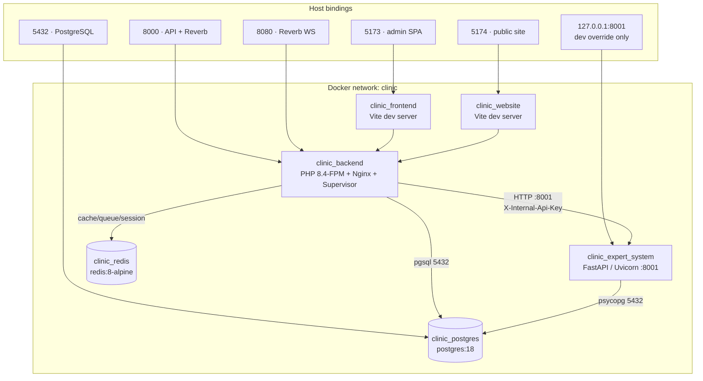
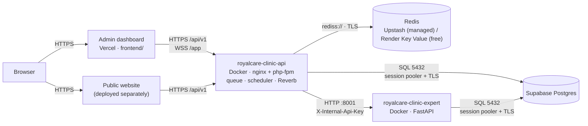

# 10 · Deployment & Infrastructure

> **Status:** No production deployment has been performed or verified in this
> working copy. Everything below is a configuration guide. **Unverified** means
> it cannot be confirmed from this repository.

## 10.1 Local Deployment Architecture

The stack is orchestrated by Docker Compose over an isolated bridge network named
`clinic`. Six services share that network; only four publish host ports.



### Development warnings

The base Compose file is a **development** stack:

- `backend` bind-mounts the source (`./backend:/var/www/html`) and hardcodes
  `APP_ENV: local`.
- `frontend` and `website` run `npm run dev`, not production builds.
- `postgres` publishes `5432` on the host.
- `docker-compose.override.yml` publishes the expert system on `127.0.0.1:8001`.

**Do not deploy this configuration to production.**

## 10.2 Service Topology

| Container | Base image | Internal ports | Host ports | Responsibility |
| --- | --- | --- | --- | --- |
| `clinic_backend` | `backend/Dockerfile` (php:8.4-fpm) | `8000`, `8080` | `${BACKEND_PORT}` (8000), `${REVERB_PORT}` (8080) | Nginx + PHP-FPM, plus Supervisor running the queue worker, scheduler, Reverb, and the Telegram poller |
| `clinic_frontend` | `frontend/Dockerfile` (Node 22) | `5173` | `${FRONTEND_PORT}` (5173) | Admin dashboard dev server |
| `clinic_website` | `website/Dockerfile` (Node 22) | `5174` | `${WEBSITE_PORT}` (5174) | Public website dev server |
| `clinic_expert_system` | `expert-system/Dockerfile` (python:3.12-slim) | `8001` | none in base; `127.0.0.1:8001` in the dev override | FastAPI rule engine |
| `clinic_postgres` | `postgres:18` | `5432` | `${POSTGRES_PORT}` (5432) | Durable system of record |
| `clinic_redis` | `redis:8-alpine` | `6379` | none | Cache, sessions, queues |

Volumes: `postgres_data` (database files) and `redis_data` (cache). Both survive
`docker compose down`; only `docker compose down -v` deletes them.

Health checks:

| Service | Check | Interval / retries |
| --- | --- | --- |
| `postgres` | `pg_isready -U $POSTGRES_USER -d $POSTGRES_DB` | 5 s / 10 |
| `redis` | `redis-cli ping` | 5 s / 10 |
| `expert-system` | `GET /health` from inside the container | 30 s / 3, 15 s start period |

`backend` waits for `postgres` and `redis` to be healthy and for
`expert-system` to have started.

### Backend container contents

`backend/Dockerfile` builds an image that:

- Installs `pdo_pgsql`, `pcntl`, and the phpredis extension.
- Copies Nginx, PHP, and Supervisor configuration from `backend/docker/`.
- Runs Nginx on `8000` inside the container.
- Starts PHP-FPM, Nginx, `queue:work`, `schedule:work`, Reverb, and
  `telegram:poll` under Supervisor.
- Runs an OPcache warmup step against `/up` after startup.

**Migrations are never run automatically.** They are a deliberate release step.

## 10.3 Configuration & Environment Variables

Three `.env` files exist and serve different layers:

| File | Consumer | Committed example |
| --- | --- | --- |
| `.env` (repo root) | Docker Compose variable substitution | `.env.example` |
| `backend/.env` | Laravel application | `backend/.env.example` |
| `frontend/.env`, `website/.env` | Vite build/dev server | `.env.example` in each app |

Never commit a real `.env`. Never paste a real secret into an issue, a chat, or a
document. Rotate anything that has been exposed.

### 10.3.1 Root Compose variables

| Variable | Default | Purpose |
| --- | --- | --- |
| `POSTGRES_DB` | `clinic_db` | Database name |
| `POSTGRES_USER` | `clinic_user` | Database user |
| `POSTGRES_PASSWORD` | `change_me` | **Replace before use** |
| `POSTGRES_PORT` | `5432` | Host port for PostgreSQL |
| `BACKEND_PORT` | `8000` | Host port for the API |
| `FRONTEND_PORT` | `5173` | Host port for the admin SPA |
| `WEBSITE_PORT` | `5174` | Host port for the public site |
| `REVERB_PORT` | `8080` | Host port for Reverb |
| `EXPERT_SYSTEM_URL` | `http://expert-system:8001` | Internal expert-system URL |
| `EXPERT_SYSTEM_TIMEOUT` | `15` | Laravel → expert-system timeout (seconds) |
| `EXPERT_SYSTEM_CONNECT_TIMEOUT` | `2` | Connect timeout (seconds) |
| `EXPERT_SYSTEM_API_KEY` | empty | Shared internal secret; set in production |
| `EXPERT_SYSTEM_LOG_LEVEL` | `INFO` | Uvicorn/app log level |
| `EXPERT_RULES_CACHE_TTL_SECONDS` | `60` | Rule cache TTL; `0` disables caching |
| `EXPERT_SYSTEM_REQUEST_TIMEOUT_SECONDS` | `15` | Per-request timeout inside FastAPI |
| `EXPERT_AUDIT_ENABLED` | `false` | Store evaluation audits (privacy-sensitive) |

### 10.3.2 Backend application variables

Grouped by concern. Defaults are from `backend/.env.example`; production values
are recommendations.

| Group | Variable | Default | Production note |
| --- | --- | --- | --- |
| App | `APP_ENV` | `local` | `production` |
| App | `APP_DEBUG` | `true` | `false` |
| App | `APP_KEY` | empty | `php artisan key:generate --show`, unique per environment |
| App | `APP_URL` | `http://localhost:8000` | Public HTTPS API URL |
| App | `APP_LOCALE` / `APP_FALLBACK_LOCALE` | `en` | Keep `en` unless translations are complete |
| Database | `DB_CONNECTION` | `pgsql` | `pgsql` |
| Database | `DB_URL` | empty | Full connection URL; required on Render (Supabase session pooler) |
| Database | `DB_SSLMODE` | `prefer` | `require` for Supabase |
| Database | `DB_HOST` | `127.0.0.1` | `postgres` in Compose |
| Database | `DB_DATABASE` / `DB_USERNAME` / `DB_PASSWORD` | local placeholders | Real credentials from a secret store |
| Cache | `CACHE_STORE` | `database` | `redis` (Upstash, or Render Key Value on free tier) |
| Queue | `QUEUE_CONNECTION` | `database` | `redis`; use `database` if jobs must survive a restart |
| Session | `SESSION_DRIVER` | `database` | `redis` if cookie sessions are used; bearer-token SPA does not need it |
| Redis | `REDIS_HOST` / `REDIS_PORT` / `REDIS_PASSWORD` | empty | Upstash RESP endpoint + password (TLS via `REDIS_SCHEME=tls`) |
| Redis | `REDIS_URL` | empty | Render Key Value internal URL (free-tier fallback; wins while `REDIS_HOST` is empty) |
| Session | `SESSION_SECURE_COOKIE` | `false` | `true` behind TLS |
| Session | `SANCTUM_EXPIRATION` | `480` | Reviewed token lifetime in minutes |
| CORS | `CORS_ALLOWED_ORIGINS` | `http://localhost:5173,http://localhost:5174` | Exact HTTPS origins only |
| CORS | `FRONTEND_URL` | `http://localhost:5173` | Admin SPA HTTPS URL |
| Auth | `AUTH_OTP_ENABLED` | `false` | Enable after SMTP is verified |
| Auth | `AUTH_2FA_MANDATORY` | `false` | Enable only after staff enrollment |
| Auth | `AUTH_LOCKOUT_ENABLED` | `false` | Optional progressive lockout |
| Auth | `AUTH_REQUIRE_VERIFIED_EMAIL` | `false` | Enable once mail delivery is reliable |
| Auth | `AUTH_ENFORCE_TRUSTED_DEVICE` | `false` | Optional |
| Auth | `AUTH_PASSWORD_MIN` | `8` | Raise per clinic policy |
| Auth | `AUTH_TRUSTED_DEVICE_DAYS` | `30` | Cookie lifetime |
| Auth | `AUTH_STEP_UP_TTL_MINUTES` | `10` | Step-up grant lifetime |
| Auth | `AUTH_INVITATION_EXPIRE_HOURS` | `72` | Invitation validity |
| Auth | `AUTH_SECURITY_ALERTS_ENABLED` | `true` | Security notification emails |
| Files | `FILESYSTEM_DISK` | `local` | Private disk; `s3` or Cloudinary if configured |
| Files | `DOCUMENTS_DISK` | `local` | `cloudinary` on Render (ephemeral disk) |
| Files | `DOCUMENTS_MAX_SIZE_KB` | `10240` (10 MB) | Must stay under the proxy body limit |
| Files | `FILE_SCANNER_DRIVER` | `null` | `clamav` for virus scanning |
| Files | `CLOUDINARY_*` | empty | Optional media storage |
| Mail | `MAIL_*` | `smtp` | Working SMTP/API provider |
| Realtime | `REVERB_APP_ID` / `REVERB_APP_KEY` / `REVERB_APP_SECRET` | empty | Required for realtime chat |
| Realtime | `REVERB_HOST` / `REVERB_PORT` / `REVERB_SCHEME` | `localhost` / `8080` / `http` | Public values; `https` behind TLS |
| Realtime | `REVERB_SERVER_HOST` / `REVERB_SERVER_PORT` | `0.0.0.0` / `8080` | Internal bind address; Render proxies `/app` |
| Telegram | `TELEGRAM_ENABLED` | `false` | Requires bot token |
| Telegram | `TELEGRAM_BOT_TOKEN` / `TELEGRAM_WEBHOOK_SECRET` | empty | Secret store only |
| Telegram | `TELEGRAM_POLLING_ENABLED` | `true` | Set `false` when Telegram is disabled (avoids a restart loop) |
| Seeding | `SEED_DEMO_USERS` | `false` | `true` only for a hosted demo; never with real patient data |
| Docs | `SCRAMBLE_DEV_TOOLS` | see `.env.example` | API docs are admin-gated outside `local` |
| Expert | `EXPERT_SYSTEM_*` | see root table | Must match the Compose values |

### 10.3.3 SPA build variables

| App | Variable | Purpose |
| --- | --- | --- |
| Both | `VITE_API_URL` | API base URL, no trailing slash |
| Admin | `VITE_PUBLIC_SITE_URL` | "View website" link |
| Admin | `VITE_REVERB_APP_KEY` / `_HOST` / `_PORT` / `_SCHEME` | Must match backend Reverb values |
| Website | — | Only `VITE_API_URL` |

`VITE_*` values are inlined at build time and shipped to the browser. Never put a
secret in one. Rebuild after any change.

## 10.4 TLS and Reverse Proxy

The API is the only browser-facing backend. Terminate TLS at a reverse proxy and
forward to `backend:8000` over the private network. An example configuration
lives in [`docker/nginx/clinic.conf.example`](../../docker/nginx/clinic.conf.example)
with notes in [`docker/nginx/README.md`](../../docker/nginx/README.md).

Requirements:

- Mount certificates read-only and configure renewal.
- Redirect HTTP to HTTPS.
- Add HSTS, `X-Content-Type-Options`, `X-Frame-Options`, and a referrer policy
  (the example proxy does this).
- Keep PostgreSQL, Redis, and the expert system unpublished.
- Support WebSocket upgrade for Reverb on `8080`, or disable realtime features.
- **Raise the body limit.** The example proxy sets `client_max_body_size 8m`,
  while the backend allows `64m`. Raise the proxy to at least `64m` before
  enabling large document uploads.

## 10.5 Deployment Procedure

### Phase 1 — Prepare configuration

```powershell
# 1. Root Compose values
Copy-Item .env.example .env

# 2. Backend application values
Copy-Item backend\.env.example backend\.env

# 3. SPA build values (host builds only)
Copy-Item frontend\.env.example frontend\.env
Copy-Item website\.env.example website\.env
```

Set `POSTGRES_PASSWORD`, then generate the application key after the first
build:

```powershell
docker compose up -d --build
docker compose exec backend php artisan key:generate
```

### Phase 2 — Start the stack

```powershell
docker compose up -d --build
docker compose ps
```

Expected: `postgres`, `redis`, and `expert-system` report `healthy`; the rest
report `Up`.

To run only the API tier:

```powershell
docker compose up -d --build backend expert-system postgres redis
```

### Phase 3 — Initialize a new database

> Only on an empty database. Never against existing clinic data.

```powershell
docker compose exec backend php artisan migrate
docker compose exec backend php artisan db:seed
```

`db:seed` runs `RolePermissionSeeder`, `AdminUserSeeder`, `ShiftTemplateSeeder`,
and the website content seeders, plus demo users and demo clinic content when
`APP_ENV` is `local` or `testing`.

### Phase 4 — Build production SPA bundles

Do not ship the dev-server images. Build static bundles:

```powershell
cd frontend
npm ci
$env:VITE_API_URL = "https://api.example.com/api/v1"
$env:VITE_PUBLIC_SITE_URL = "https://www.example.com"
npm run build

cd ..\website
npm ci
$env:VITE_API_URL = "https://api.example.com/api/v1"
npm run build
```

| App | Output |
| --- | --- |
| Admin dashboard | `frontend/dist/` |
| Public website | `website/dist/` |

Serve `dist/` from a static host, CDN, or Nginx with an SPA fallback:

```nginx
location / {
  try_files $uri $uri/ /index.html;
}
```

Cache hashed `assets/` aggressively; do not long-cache `index.html`.

## 10.6 Production Override

Create a `docker-compose.prod.yml` that removes development behaviour. The
snippet is illustrative:

```yaml
services:
  backend:
    restart: unless-stopped
    environment:
      APP_ENV: production
      APP_DEBUG: "false"
    volumes:
      - ./backend/storage:/var/www/html/storage
    ports: !reset []
    expose:
      - "8000"
      - "8080"

  postgres:
    restart: unless-stopped
    ports: !reset []

  redis:
    restart: unless-stopped

  expert-system:
    restart: unless-stopped
    ports: !reset []
```

Notes:

- `!reset` is a Compose feature. Confirm your Compose version supports it —
  **Unverified** for all versions. If not, copy the base file and delete the
  `ports:` entries.
- `docker-compose.override.yml` must not exist on the production host.
- Start with explicit files so the dev override is ignored:

  ```powershell
  docker compose -f docker-compose.yml -f docker-compose.prod.yml up -d --build
  ```

> **Build-context warning:** `backend/.dockerignore` does not exclude `.env`,
> and `backend/Dockerfile` runs `COPY . .`. A local `backend/.env` can be baked
> into the image. Add a reviewed `.dockerignore` exclusion before building a
> production image.

## 10.7 Database Release Step

Before any migration against production data:

1. Take a verified backup.
2. Review the pending migration files.
3. Confirm a restore or rollback plan.
4. Announce a maintenance window if the change is disruptive.

```powershell
docker compose -f docker-compose.yml -f docker-compose.prod.yml exec backend php artisan migrate:status
docker compose -f docker-compose.yml -f docker-compose.prod.yml exec backend php artisan migrate --force
```

Rules:

- Never run `db:seed` in production.
- Never run `migrate:fresh`, `db:wipe`, or `docker compose down -v` against
  clinic data.
- Create real accounts through invitations and approvals, not seeders.

## 10.8 Release Sequence

1. Build and tag the backend and expert-system images.
2. Build both SPA bundles with production `VITE_*` values.
3. Back up the database.
4. Deploy the new images and static bundles.
5. Run `php artisan migrate --force` if migrations are pending.
6. Clear stale caches when configuration changed.
7. Restart the backend so Supervisor reloads the queue worker, scheduler,
   Reverb, and Telegram poller.
8. Run health and smoke checks.
9. Watch logs and `failed_jobs`.

```powershell
docker compose exec backend php artisan config:clear
docker compose exec backend php artisan route:clear
docker compose restart backend
```

`route:clear` matters after changing `AUTH_2FA_MANDATORY`, because the
`2fa.enrolled` middleware is resolved at route-registration time.

## 10.9 Health Checks and Smoke Tests

| Check | Command | Expected |
| --- | --- | --- |
| API liveness | `GET https://api.example.com/up` | `200` |
| Public website API | `GET https://api.example.com/api/v1/website/bootstrap` | `200` JSON |
| Expert system (internal) | `docker compose exec expert-system python -c "import urllib.request;print(urllib.request.urlopen('http://127.0.0.1:8001/health').read())"` | `{"status":"ok",...}` |
| Containers | `docker compose ps` | All up; health checks passing |
| Logs | `docker compose logs --tail=100 backend` | No repeating fatal errors |
| Queue | Inspect `failed_jobs` and worker logs | No unexpected growth |
| Local API docs | `http://localhost:8000/docs/api` | Scramble UI (admin-gated outside `local`) |

The expert-system health endpoint must never be reachable from the internet.

## 10.10 Backups and Recovery

Minimum requirements:

- Nightly logical backup: `pg_dump --format=custom`.
- Encrypted, access-controlled, off-host storage.
- Retention aligned with clinic policy and applicable law.
- Periodic restore tests into a scratch database.
- Back up uploaded documents when a local disk is used; Cloudinary/S3 shifts
  the object storage but not the database metadata.
- Record the release commit with each backup.

Restore procedure (into a scratch database first):

```powershell
docker compose exec -T postgres pg_restore -U $env:POSTGRES_USER -d clinic_restore --clean --if-exists < backup.dump
```

Never restore over the live database without a second verified backup.

## 10.11 Rollback

Plan rollback before deploying:

1. Keep the previous image tags and SPA bundles.
2. Keep a pre-deployment database backup.
3. Know which migrations are irreversible.
4. For an incompatible migration, restore from backup rather than guessing with
   `migrate:rollback`.
5. Redeploy the previous images and bundles.
6. Re-run health and smoke checks.

## 10.12 Production Readiness Checklist

- [ ] Production Compose file excludes `docker-compose.override.yml`
- [ ] `APP_ENV=production`, `APP_DEBUG=false`
- [ ] Strong unique `APP_KEY`
- [ ] Strong database password; PostgreSQL not published
- [ ] Redis not published
- [ ] Expert system not published
- [ ] `EXPERT_SYSTEM_API_KEY` set and identical in backend and expert system
- [ ] `EXPERT_AUDIT_ENABLED` decided with privacy review
- [ ] `CORS_ALLOWED_ORIGINS` contains only real HTTPS origins
- [ ] `APP_URL` and `FRONTEND_URL` use HTTPS
- [ ] `SESSION_SECURE_COOKIE=true`
- [ ] Mail provider configured and delivery tested
- [ ] Reverb scheme `https` and WebSocket proxy configured, or realtime disabled
- [ ] SPAs built with production `VITE_*` values
- [ ] SPA fallback configured for deep links
- [ ] TLS certificate installed with automatic renewal
- [ ] Proxy body limit raised to match upload limits
- [ ] Backups configured and a restore tested
- [ ] Migrations applied deliberately, never automatically
- [ ] `backend/.env` excluded from the image build context
- [ ] No demo data seeded; demo accounts removed or disabled
- [ ] Admin password changed from any seeded value
- [ ] Invitations and approvals tested end to end
- [ ] 2FA and lockout enabled only after staff enrollment
- [ ] Logs monitored and secrets excluded
- [ ] Third-party licenses and notices retained

See the [Administrator Security Runbook](../ADMIN_SECURITY_RUNBOOK.md) for
hardening and rollout sequencing.

## 10.13 Render + Supabase + Vercel Deployment

The repository root contains [`render.yaml`](../../render.yaml), a Render
Blueprint for the **backend only**. **Render Postgres is not used.** Supabase is
the system of record, Render runs the two containers, and the React admin
dashboard is hosted on Vercel.

> **Status:** verified against a live deployment (November 2026). The API and
> expert containers are live on Render, the database is Supabase, and the admin
> SPA is built from `frontend/`.

### 10.13.1 Topology



| Render resource | Type | Plan | Public? | Purpose |
| --- | --- | --- | --- | --- |
| `royalcare-clinic-api` | Docker web service | `free` | Yes | Laravel API, Reverb, queue worker, scheduler |
| `royalcare-clinic-expert` | Docker web service | `free` | Yes, key-protected | FastAPI rule engine |
| `royalcare-clinic-redis` | Key Value | `free` | No (internal only) | Cache, sessions, queues (free-tier fallback) |
| Upstash Redis | Managed Redis | paid/free tier | No (credentials) | Production cache, sessions, queues (TLS) |

The API uses `CACHE_STORE=redis`, `SESSION_DRIVER=redis`, and
`QUEUE_CONNECTION=redis`. It reaches Redis through `REDIS_URL` (Render Key
Value) with `REDIS_CLIENT=phpredis`, or through the Upstash `REDIS_HOST` /
`REDIS_PORT` / `REDIS_PASSWORD` / `REDIS_SCHEME=tls` settings when those are set
(see **Redis (Upstash, production)** below).

Render's free Key Value is **25 MB, internal-only, and not persistent**: cache
entries, sessions, and queued jobs are lost when the instance restarts or
redeploys. That is acceptable for the demo (users re-login, queued jobs are
re-run by the scheduler), but if jobs must survive a restart, set
`QUEUE_CONNECTION=database` and keep the durable `jobs` table in Supabase.

The reference-data marker is deliberately stored in the **`database` cache
store**, not Redis, so the idempotent seeding survives a Redis wipe.

#### Redis (Upstash, production)

The Render Key Value is a free-tier convenience: it is internal-only and **not
persistent**, so a restart drops sessions and queued jobs. For anything that
must survive restarts — or that needs TLS and an external connection — use a
managed **Upstash Redis** database instead. Laravel's `phpredis` client connects
to Upstash over TLS with the same configuration it uses for any Redis.

> **Use the native RESP/TCP endpoint, not the Upstash REST URL.** Upstash offers
> an HTTPS REST API (`https://<host>:443`) and a Redis-compatible endpoint on a
> different port. Laravel speaks the Redis protocol, so copy the **Redis
> connection string / endpoint** (host, port, password), never the REST URL.

1. Create a database at <https://upstash.com>. Pick a region close to the Render
   services (e.g. `ap-southeast-1` / Singapore) to keep round-trips short.
2. In the Upstash console open the database and copy the **endpoint** (host and
   port) and the **password**. If the username is not `default`, copy that too.
3. On the Render API service, set these environment variables (they are secrets:
   the Blueprint declares them with `sync: false`, so the values are entered in
   the dashboard, never stored in `render.yaml`):

   | Variable | Value | Notes |
   | --- | --- | --- |
   | `REDIS_HOST` | `<region>.upstash.io` | Upstash RESP endpoint host |
   | `REDIS_PORT` | `6379` | RESP port from the Upstash console; **not** the REST port 443 |
   | `REDIS_PASSWORD` | `<upstash password>` | From the Upstash console |
   | `REDIS_USERNAME` | `default` | Only if Upstash uses a username |
   | `REDIS_SCHEME` | `tls` | Upgrades the connection to TLS |
   | `REDIS_CLIENT` | `phpredis` | Already the default in the Blueprint |
   | `REDIS_DB` | `0` | Queue + sessions |
   | `REDIS_CACHE_DB` | `1` | Cache (kept separate on purpose) |
   | `CACHE_STORE` | `redis` | |
   | `QUEUE_CONNECTION` | `redis` | |
   | `SESSION_DRIVER` | `redis` | Only if not using bearer tokens (see below) |

   When `REDIS_HOST` is set, it takes precedence over the Key Value `REDIS_URL`,
   so the same Blueprint supports both. Leave `REDIS_HOST` blank to fall back to
   the internal Key Value.
4. **Sessions.** The shipped SPA authenticates with **Sanctum bearer tokens**,
   so it does not need server-side sessions; `SESSION_DRIVER=redis` is optional.
   Keep `SESSION_DRIVER=redis` only if you enable cookie-based auth (then also set
   `SANCTUM_STATEFUL_DOMAINS` to the SPA origin). Bearer-token clients are
   unaffected either way.
5. Redeploy the API so the new variables take effect.

##### TLS failure mode: `read error on connection` at AUTH

If the logs show

```text
RedisException: read error on connection to <region>.upstash.io:6379
  at PhpRedisConnector.php ... $client->auth([$config['username'], $config['password']])
```

the connection was opened as **plain TCP** against Upstash's TLS-only port. Upstash
accepts the TCP socket, never negotiates TLS, and drops the client when it sends a
plaintext `AUTH` — which surfaces as a read error on the very next command. The
cause is a missing `REDIS_SCHEME=tls`: without it Laravel passes the bare host to
phpredis, and phpredis never prepends `tls://`. The fix is exactly the
`REDIS_SCHEME=tls` variable above; verify it is present **and** that `REDIS_HOST`
is also present (a non-empty `REDIS_URL` would otherwise win and disable TLS).

If the same symptom persists after the fix, check in order: the password is
correct and not truncated in the Render dashboard, the database is not paused or at
its request limit, the Upstash region matches, and the API's outbound IP is not
blocked. Upstash's free tier is TLS-only; there is no plain-TCP fallback.

##### Queue worker outage behaviour

`docker/supervisord.conf` runs the worker as
`queue:work --sleep=1 --tries=3 --max-time=3600` with `startsecs=5` and
`startretries=5`. If Redis stays unreachable, five consecutive failed starts move
the program to Supervisor's `FATAL` state and it stops respawning it — preventing
the noisy restart loop seen during the outage. The normal hourly `--max-time` exit
runs far longer than `startsecs`, so it is still treated as a clean start and
restarted as intended. Recovery from `FATAL` needs a container restart (a redeploy
or a manual restart on Render). Retry/failure handling is unchanged: each job
still uses `tries=3`, and failures land in the `failed_jobs` table in Supabase.

Verify connectivity from a one-off Render **Shell** (or locally against Upstash)
before declaring it production-ready:

```bash
php artisan tinker --execute="cache()->store('redis')->put('rc:ping', now()->toIso8601String(), 10); echo cache()->store('redis')->get('rc:ping').PHP_EOL;"
php artisan tinker --execute="echo 'conn: '.config('database.redis.default.host').':'.config('database.redis.default.port').' tls='.(config('database.redis.default.scheme') ?? 'plain').PHP_EOL;"
```

A returned timestamp and `tls=tls` confirm a working, encrypted connection.

#### Redis connectivity diagnostic (temporary, Admin-only)

The Render free plan has no shell access, so the commands above cannot be run
against the deployed container. As a temporary substitute, the API exposes a
single Admin-only endpoint that pings the **actual configured default Redis
connection** and returns a fixed, non-leaking payload.

```text
GET /api/v1/system/redis-health
```

It sits behind `auth:sanctum` (401 for guests) and the `system.health.view`
permission, which only the **Admin** role holds (403 for every other role). The
response is always one of:

```json
{ "status": "ok", "connected": true }
```

```json
{ "status": "error", "connected": false, "message": "Redis connection failed." }
```

It never includes the host, port, username, password, DSN, exception class or
stack trace, and it never returns a hardcoded success.

**Exact request to verify the deployed connection**

```bash
curl -s -o /dev/null -w '%{http_code}\n' \
  -H 'Accept: application/json' \
  -H 'Authorization: Bearer <ADMIN_SANCTUM_TOKEN>' \
  https://royalcare-clinic-api.onrender.com/api/v1/system/redis-health
```

Expected `200`. Then read the body:

```bash
curl -s \
  -H 'Accept: application/json' \
  -H 'Authorization: Bearer <ADMIN_SANCTUM_TOKEN>' \
  https://royalcare-clinic-api.onrender.com/api/v1/system/redis-health
```

- `{"status":"ok","connected":true}` → Redis is reachable and authenticated.
- `{"status":"error","connected":false,"message":"Redis connection failed."}` →
  the app could not establish the connection (or authenticate). Check the
  `REDIS_*` environment variables, the Upstash region/TLS settings, and
  Upstash's request/connection limits.

Create the token by logging in as an admin via `POST /api/v1/auth/login` (or from
the SPA → Dev Tools → localStorage, if a token was stored). Because the endpoint
is temporary and gated, it does not need a separate rate limit beyond the
standard `api` throttle (60/min per user).

**Removing the diagnostic after verification**

1. Delete `backend/app/Http/Controllers/Api/RedisHealthController.php`.
2. Remove the route line in `backend/routes/api.php`:
   `Route::get('/system/redis-health', [RedisHealthController::class, 'check']);`
   and the `use App\Http\Controllers\Api\RedisHealthController;` import.
3. Delete `backend/tests/Feature/RedisHealthTest.php`.
4. Deploy. The endpoint disappears with the container that no longer contains it.

**Cache strategy.** Only low-volatility, non-financial data is cached:

- Dashboard analytics (`dashboard:analytics`) and the `appointments` report are
  cached with a stale-within grace period and invalidated on the relevant model
  writes (which also emit a realtime `DashboardMetricsUpdated` signal).
- **`summary`, `revenue` and `inventory` are never cached.** They aggregate
  payments, invoices, balances and stock levels, which must stay
  database-authoritative (see `ReportController`). This trades a little report
  speed for guaranteed correctness on money and stock.
- The reference-data marker uses the **`database`** store so seeding survives a
  Redis flush.

**Queue worker.** No separate Render service is required: `php artisan
queue:work` already runs under Supervisor inside the API container
(`backend/docker/supervisord.conf`), currently as
`queue:work --sleep=1 --tries=3 --max-time=3600`. It uses `QUEUE_CONNECTION`, so
pointing that at Redis is enough. If you later need a dedicated worker, add a
Render **Background Worker** with start command:

```bash
php artisan queue:work redis --sleep=3 --tries=3 --timeout=90 --max-time=3600
```

and disable the in-container worker to avoid double-processing. Failed jobs land
in the `failed_jobs` table in Supabase (`QUEUE_FAILED_DRIVER=database-uuids`);
inspect them with `php artisan queue:failed` and retry with `php artisan
queue:retry all`.

The API container exposes one public port (`8000`). nginx proxies `/app` (and
`/apps`) to Reverb on `127.0.0.1:8080`, so browsers use
`wss://royalcare-clinic-api.onrender.com/app/<key>` and Render only has to route
a single HTTP port.

The admin dashboard and the public website are **not** part of `render.yaml`.
Deploy them separately and point their `VITE_API_URL` at the API.

### 10.13.2 Create the Supabase database

1. Create a project at <https://supabase.com/dashboard>. Choose the **same
   region as the Render services** (`singapore` in the Blueprint). Cross-region
   round-trips are the dominant cost on a free Supabase plan: a migration that
   takes seconds locally can take minutes from another continent, and the
   knowledge-base seeder is a few hundred statements.
2. Wait for the database to finish provisioning.
3. Open **Project Settings → Database → Connection string** and select
   **Session pooler** (not *Direct* and not *Transaction pooler*).
4. Copy the URI and replace the password placeholder. Keep port **5432** and
   append `?sslmode=require` if it is not already present.
5. If the password contains `@`, `:`, `/`, `?`, `#`, or `%`, URL-encode it. The
   dashboard's copy button already produces an encoded URI.
6. Do **not** use the `anon` or `service_role` API keys here. Laravel and the
   expert system connect with the PostgreSQL user and password.

Example (the `<...>` placeholders are not literal):

```text
postgresql://postgres.<project-ref>:<url-encoded-password>@aws-0-<region>.pooler.supabase.com:5432/postgres?sslmode=require
```

Why the session pooler:

- It is reachable over IPv4; Supabase's direct hostname may resolve to IPv6
  only, which Render's free egress does not support.
- It supports prepared statements. The transaction pooler on port `6543` does
  not, and Laravel's PDO layer relies on them.
- It multiplexes many short-lived PHP connections, which suits the API's
  request-per-process model.

The connection uses the `postgres` role, which bypasses Supabase Row Level
Security. Treat the URI as a root credential: store it only in Render's
environment variables (the Blueprint prompts for it with `sync: false`) and
never commit it.

### 10.13.3 Create the Render services

Either apply the Blueprint (`New → Blueprint`, which prompts for `DB_URL` and
generates `APP_KEY`, `REVERB_APP_SECRET`, and `EXPERT_SYSTEM_API_KEY`) or create
the two web services manually with the same settings:

| Setting | API | Expert |
| --- | --- | --- |
| Runtime | Docker | Docker |
| Root Directory | `backend/` | `expert-system/` |
| Dockerfile | `./Dockerfile` | `./Dockerfile` |
| Docker Command | `/usr/local/bin/render-entrypoint.sh` | *(image default)* |
| Health Check Path | `/up` | `/health` |
| Plan / Region | Free / Singapore | Free / Singapore |
| `PORT` | `8000` | `8001` |

Create one **Key Value** instance named `royalcare-clinic-redis` (free,
Singapore, internal only) and copy its **Internal Redis URL** into the API's
`REDIS_URL`. Then set `REDIS_CLIENT=phpredis`, `CACHE_STORE=redis`,
`SESSION_DRIVER=redis`, and `QUEUE_CONNECTION=redis`. With the Blueprint this
is wired with `fromService`; manually, paste the internal URL.

`DB_URL` on the API and `DATABASE_URL` on the expert service must point at the
same Supabase session-pooler URI. `EXPERT_SYSTEM_API_KEY` must be identical on
both services; the API sends it as `X-Internal-Api-Key`.

Set `REVERB_APP_KEY=royalcare-clinic-key` and
`REVERB_APP_SECRET=<random>` on the API. The key is public (it is embedded in the
SPA bundle); the secret is not.

If you rename a service or attach a custom domain, update every derived value:

| Value | Where |
| --- | --- |
| `APP_URL`, `EXPERT_SYSTEM_URL` | API service environment |
| `FRONTEND_URL`, `CORS_ALLOWED_ORIGINS`, `SANCTUM_STATEFUL_DOMAINS` | API service environment (add the Vercel production origin) |
| `VITE_API_URL`, `VITE_PUBLIC_SITE_URL`, `VITE_REVERB_*` | Vercel project environment (rebuild required) |
| `REVERB_APP_KEY` | Must stay identical in the API and the Vercel project |

### 10.13.4 First deploy and seeding

The API image starts through
[`backend/docker/render-entrypoint.sh`](../../backend/docker/render-entrypoint.sh),
which is idempotent:

1. Exports `HOME=/var/www`. libpq looks for a client certificate under `$HOME`;
   Supervisor would otherwise inherit `HOME=/root`, which `www-data` cannot
   traverse, and every PDO connection would fail with
   `could not open certificate file "/root/.postgresql/postgresql.crt"`.
2. Recreates the writable `storage/` and `bootstrap/cache/` directories and the
   public storage symlink.
3. Retries `php artisan migrate --force` up to 10 times (Supabase may still be
   waking up on the first attempt).
4. Starts `php artisan app:ensure-reference-data` **in the background** and
   immediately execs Supervisor, so the port binds and the health check passes
   while roles, the bootstrap administrator and the medical knowledge base are
   seeded. Progress is written to `storage/logs/seed.log`.
5. Supervisor starts nginx, php-fpm, the queue worker, the scheduler, Reverb,
   and the Telegram poller.

`app:ensure-reference-data` records a `reference-data-seeded` marker in the
`database` cache store once `ProductionSeeder` succeeds, so later boots skip the
work. The seeders are idempotent and keyed on the unique `code` columns; an
interrupted run is retried on the next boot. The knowledge-base seeder uses
set-based `upsert`/`insert` statements (a handful of round-trips) rather than one
query per record, which is what keeps a cold deploy inside Render's window.

`SEED_DEMO_USERS=true` additionally creates the demo logins. The `initialDeployHook`
in `render.yaml` runs `php artisan db:seed` **once per service** to add the demo
content; the entrypoint's reference seeding runs on every boot.

Demo accounts created by the hook:

| Username | Email | Password | Role |
| --- | --- | --- | --- |
| `admin` | `admin@clinic.local` | `Admin@12345` | Admin |
| `doctor` | `doctor@clinic.local` | `Password@12345` | Doctor |
| `nurse` | `nurse@clinic.local` | `Password@12345` | Nurse |
| `headnurse` | `headnurse@clinic.local` | `Password@12345` | Head Nurse |
| `receptionist` | `receptionist@clinic.local` | `Password@12345` | Receptionist |
| `pharmacist` | `pharmacist@clinic.local` | `Password@12345` | Pharmacist |
| `patient` | `patient@clinic.local` | `Password@12345` | Patient |

Change the admin password immediately after the first login. The free plan has
no Shell or one-off jobs, so if the seeders need to be re-run later, run them
locally against the same `DB_URL`:

```powershell
cd backend
php artisan db:seed --force
```

The bootstrap admin is recreated whenever the reference-data seeder runs (every
boot until the marker is set), but an existing admin password is never
overwritten in production.

### 10.13.5 Smoke tests

| Check | Expected |
| --- | --- |
| `GET https://royalcare-clinic-api.onrender.com/up` | `200` |
| `GET https://royalcare-clinic-expert.onrender.com/health` | `{"status":"ok",...}` |
| `GET https://royalcare-clinic-expert.onrender.com/ready` | `{"status":"ready","database":"ok"}` |
| `GET /api/v1/knowledge-base/diseases` (admin token) | `total` is 20 |
| `GET /api/v1/knowledge-base/symptoms` (admin token) | `total` is 63 |
| `GET /api/v1/knowledge-base/expert-rules` (admin token) | `total` is 20 |
| `POST /api/v1/expert-system/evaluate` with symptom IDs | `matched_rules` is not empty |
| Admin dashboard on Vercel | SPA loads; a deep link (e.g. `/patients`) reloads correctly |
| Admin login with a demo account | `200`; dashboard loads |
| Browser console | No CORS errors; WebSocket connects to `wss://.../app/...` |

If the expert call fails, check in order: `EXPERT_SYSTEM_URL`, the generated
`EXPERT_SYSTEM_API_KEY` on both services, the expert service's `/health`, and
the Supabase connection from the expert logs. Free services sleep, so the first
call after idle can take up to a minute; the API allows a 60-second expert
timeout for this reason.

If the knowledge base is still empty, read `storage/logs/seed.log` in the API
logs: `app:ensure-reference-data` prints per-phase progress and the elapsed time.
The seeding runs in the background, so a deploy can be "live" before the data
lands.

### 10.13.6 Free-tier caveats

- **Web services sleep after ~15 minutes of inactivity.** The next request
  cold-starts the container (often 30–60 seconds). WebSocket clients disconnect
  and reconnect. The API's migrations and reference seeders run again on wake,
  which is safe because they are idempotent.
- **750 free instance hours per month per workspace**, pooled across services.
  Two always-on services would exceed the allowance; the idle spin-down is what
  keeps the demo inside it.
- **The free Key Value is 25 MB, internal-only and non-persistent.** Cache,
  sessions and queued jobs disappear on restart/redeploy. Log everyone out, or
  move `QUEUE_CONNECTION` back to `database` if jobs must survive.
- **Supabase free projects pause after ~7 days without activity.** Resume the
  project in the Supabase dashboard if connections start failing. The API cannot
  resume it automatically.
- **The container filesystem is ephemeral.** With `DOCUMENTS_DISK=cloudinary`
  patient documents, announcement posters and website media are stored in
  Cloudinary; anything still written to `FILESYSTEM_DISK=local` is lost on every
  deploy/restart.
- **The expert service is public.** It is protected by
  `EXPERT_SYSTEM_API_KEY`; `/health` and the OpenAPI schema remain public. Do not
  put patient data in the expert request beyond symptom IDs.
- **The frontend builds on Vercel.** `VITE_*` values are inlined into the bundle
  at build time; change the env var in the Vercel project and redeploy. A
  backend-only deploy does not rebuild the SPA, and a frontend-only commit does
  not redeploy the API (`buildFilter` limits it to `backend/**`).
- **Mail is logged, not delivered.** `MAIL_MAILER=log` writes messages to the
  API logs. Password-reset and invitation emails will not arrive until SMTP is
  configured.

### 10.13.7 Production hardening

Before the deployment holds real clinic data:

- Set `SEED_DEMO_USERS=false`, delete or disable the demo accounts, and change
  the admin password.
- Replace `MAIL_MAILER=log` with a real SMTP/API provider and test delivery.
- Set `AUTH_SECURITY_ALERTS_ENABLED=true` once mail works.
- Move uploads to Cloudinary/S3 and verify `DOCUMENTS_DISK=cloudinary` plus
  `CLOUDINARY_CLOUD_NAME`, `CLOUDINARY_API_KEY`, `CLOUDINARY_API_SECRET`
  (`CLOUDINARY_FOLDER` and `CLOUDINARY_SECURE=true` are optional). Rotate the
  Cloudinary API secret if it was ever shared in plain text.
- Attach custom domains and update every URL/CORS value listed in §10.13.3.
- Enable 2FA and lockout only after staff enrollment.
- Take a Supabase `pg_dump` before destructive changes. Free projects do not
  include point-in-time recovery.
- Review the [Production Readiness Checklist](#1012-production-readiness-checklist)
  with the Render-specific substitutions above.

### 10.13.8 Moving the expert system to a private service (paid)

Render private services (`type: pserv`) and `preDeployCommand` require a paid
workspace. When upgrading:

1. Change the expert service in `render.yaml` from `type: web` to `type: pserv`
   and remove its `healthCheckPath`/public assumptions if desired.
2. Set the API's `EXPERT_SYSTEM_URL` to the private service address, for example
   `http://royalcare-clinic-expert:8001`.
3. Keep `EXPERT_SYSTEM_API_KEY` on both services.
4. Remove the expert's public URL from any firewall or documentation.
5. Redeploy the API so it picks up the new URL.

The API still reaches the expert over the workspace private network, so the
`X-Internal-Api-Key` header remains a second layer of defence rather than the
only one.

### 10.13.9 Deploy the admin dashboard to Vercel

The admin SPA lives in `frontend/` and is a plain Vite build. Import the
repository at <https://vercel.com/new> and configure:

| Setting | Value |
| --- | --- |
| Framework preset | Vite |
| Root Directory | `frontend` |
| Build Command | `npm run build` |
| Output Directory | `dist` |
| Install Command | `npm ci` (or leave the default) |

[`frontend/vercel.json`](../../frontend/vercel.json) rewrites every path to
`index.html`, so client-side routes survive a hard refresh.

Add these environment variables to the **Production** (and Preview) scope, then
deploy:

```text
VITE_API_URL=https://royalcare-clinic-api.onrender.com/api/v1
VITE_REVERB_APP_KEY=royalcare-clinic-key
VITE_REVERB_HOST=royalcare-clinic-api.onrender.com
VITE_REVERB_PORT=443
VITE_REVERB_SCHEME=https
VITE_PUBLIC_SITE_URL=<public website URL, if deployed>
```

Finally, add the Vercel production origin to the API service so the browser is
allowed to call it, and redeploy the API (environment changes restart the
container):

```text
FRONTEND_URL=https://<project>.vercel.app
CORS_ALLOWED_ORIGINS=http://localhost:5173,http://localhost:5174,https://<project>.vercel.app
SANCTUM_STATEFUL_DOMAINS=localhost:5173,localhost:5174,<project>.vercel.app
```

`sanctum` stateful domains are host names **without** the scheme. The shipped SPA
uses bearer tokens, so this only matters if cookie-based auth is enabled later.


